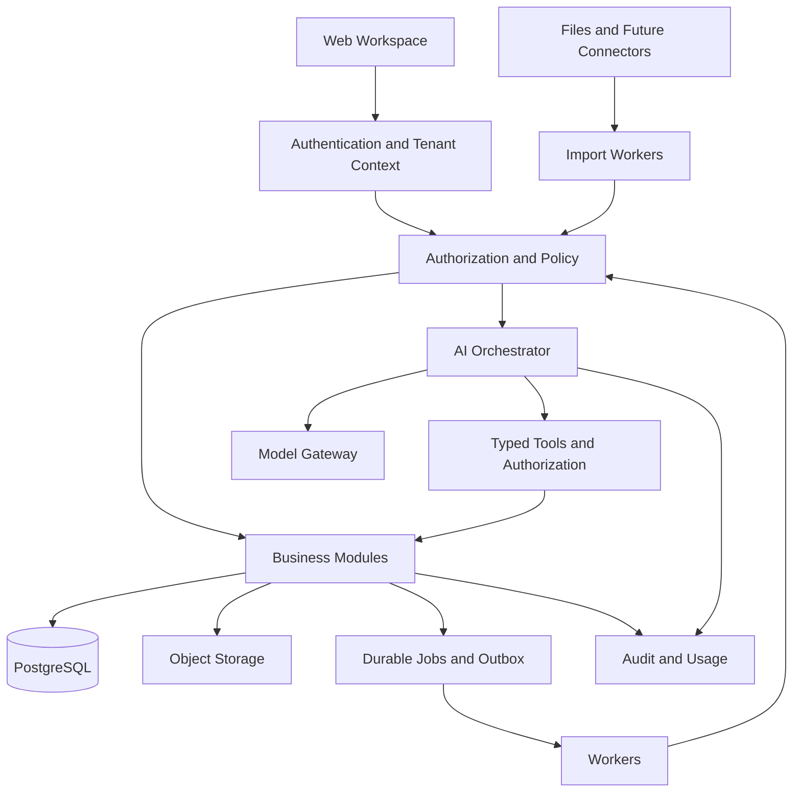
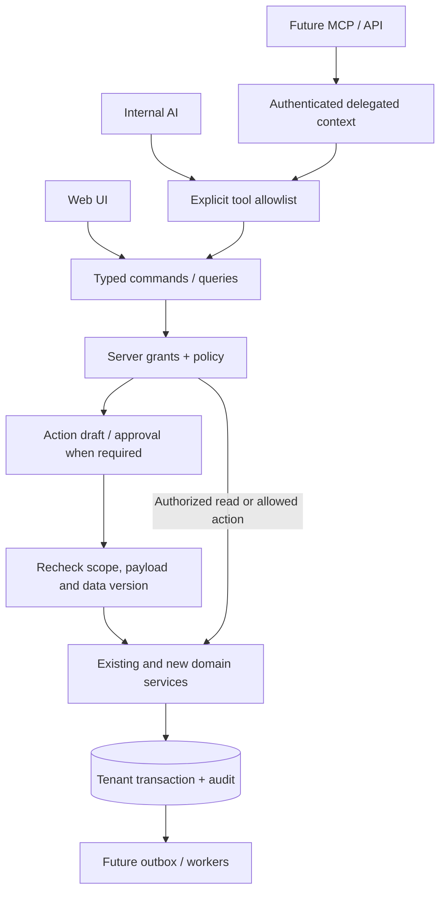

# Architecture baseline และ decisions

อัปเดต 2026-09-17: ADR-001–006 คงเป็นฐาน; ADR-007–011 เป็น target decisions ตาม [แผน Agentic Commerce](29-agentic-commerce-project-plan.md) ยังไม่ใช่ implementation ที่เปิดใช้ทั้งหมด การออกแบบนี้เพิ่ม modules ใน repo เดิมและไม่เปลี่ยน stack/hosting โดยปริยาย

## ADR-001 — Modular monolith + workers

สถานะ: ใช้เป็นแนวทางของ local foundation; ความสามารถเป้าหมายในเอกสารนี้ไม่ได้หมายความว่าพัฒนาแล้วทั้งหมด ดู implementation boundary ใน [runbook](10-foundation-runbook.md)

แอปหลักแยกโมดูล Identity/Tenancy, Catalog/Cost, Imports, Settlement, Metrics, AI/Workflow, Audit/Usage และมี workers สำหรับงานยาว สื่อสารผ่าน contracts ชัดเจนก่อนแยก deployment เพิ่มตามหลักฐานจากโหลดหรือข้อกำหนดลูกค้า

ติดตั้ง TypeScript, Next.js, PostgreSQL/Drizzle, pg-boss และ AI SDK สำหรับ local foundation แล้วตาม [stack recommendation](08-stack-recommendation.md) ใช้ npm workspaces และ CSS ในแอปนี้ ยังไม่ได้ซื้อบริการหรือเลือก production model ข้อจำกัดงบและข้อมูลยังต้องยืนยัน

## ADR-002 — Tenant เป็น security boundary

- Tenant มีหลาย legal entities และ shops ได้ ขอบเขต grant ละเอียดกว่าระดับ tenant
- User เป็น identity กลางและมี memberships หลาย tenant ได้ ไม่มีการรวมสิทธิ์ข้าม tenant โดยอัตโนมัติ
- Tenant context มาจาก session ที่ตรวจ membership ไม่เชื่อ header/body/prompt อย่างเดียว
- Agency ใช้ delegated membership/grants ต่อ tenant ลูกค้า
- Tenant routing record เผื่อ home_region, isolation_mode และ resource location โดย client แก้ routing ไม่ได้
- เริ่ม pooled storage และเตรียมทางแยกทรัพยากร การย้าย tenant และ restore ราย tenant ต้องทดสอบก่อนเสนอเป็นบริการ

Data isolation: tenant-aware keys/foreign keys, RLS, server-side grants และ scoped object access ประกอบกัน Application DB role ต้องไม่เป็น owner/superuser/BYPASSRLS ตั้ง context ภายใน transaction และทดสอบ connection reuse ว่าไม่ค้าง tenant เดิม

Async jobs ผูก tenant, actor/service principal, authorization scope และ correlation ID ตรวจสิทธิ์ล่าสุดก่อนเข้าถึงข้อมูลหรือทำงานที่มีผล ไม่ฝากความปลอดภัยไว้กับ ID ในข้อความคิวเพียงอย่างเดียว

## ADR-003 — Financial source of truth ใช้โค้ดคำนวณ

โมเดลหลัก: Tenant, Membership, LegalEntity, Shop, Product, ProductVariant, AttributeDefinition, VariantAttributeValue, CategoryMapping, ChannelSkuMapping, CostVersion, ImportBatch, SourceRecord, Order, OrderLine, FinancialEvent, SettlementStatement, Payout, AdSpend, AllocationRuleVersion, MetricSnapshot, ReviewTask

Catalog กลางไม่ผูกกับเสื้อผ้า ProductVariant เป็นหน่วยขาย/SKU ที่อ้างต้นทุน สินค้าไม่มีตัวเลือกมี default variant สี ไซซ์ กลิ่น ความจุ และวัสดุเป็น attributes ที่ตรวจชนิด/หน่วยได้ แยกค่าที่ใช้คำนวณเงินและสิทธิ์ออกจาก flexible metadata ดู [product model](09-product-model.md)

- การ reconcile statement/payout กับออเดอร์แยกจากการคำนวณกำไร
- Financial events ใช้บันทึกเพิ่ม/ปรับปรุงที่มีประวัติ ไม่อ้างว่าเป็นบัญชีแยกประเภทตามกฎหมาย
- Raw source มี lineage, checksum, adapter version และ import time; v1.1 เก็บ CSV ไม่เกิน 1 MB แบบ immutable ใน PostgreSQL และ v1.5 เพิ่ม settlement XLSX ไม่เกิน 5 MB ตาม docs/28 สำหรับ local/staging ก่อนย้าย content ไป private object storage และกำหนด retention ก่อนรับข้อมูลจริง
- มี event/effective date, source update time, currency, timezone และ sign convention
- เก็บ amount เป็น decimal ที่กำหนด scale หรือ minor units ตามสกุลเงิน ไม่ใช้ floating point
- แยก actual fees, allocated ads, estimated costs และ missing inputs อย่างชัดเจน
- เงินเหลือหลังแอด = รายได้สุทธิ - fees - affiliate - COGS - seller fulfillment costs - other attributable costs - ads ตามนิยามที่ยืนยัน
- รายได้สุทธิไม่หักส่วนลดหรือคืนเงินซ้ำกับข้อมูลต้นทาง เงินจ่ายจากแพลตฟอร์มไม่ใช่รายได้หรือกำไรโดยตัวมันเอง
- เงินรับจริงเข้าธนาคารต้องมีข้อมูลธนาคารยืนยัน หากมีเพียง settlement ให้ระบุว่าเป็นยอดตามแพลตฟอร์ม
- การแก้กฎ/ต้นทุนสร้าง snapshot รุ่นใหม่พร้อมประวัติ ไม่แก้ตัวเลขย้อนหลังอย่างเงียบ ๆ

## ADR-004 — AI ผ่าน typed tools เท่านั้น

Tools MVP:

| Tool | หน้าที่ | สิทธิ์ |
|---|---|---|
| propose_import_mapping | เสนอ mapping จากไฟล์ที่ได้รับสิทธิ์ | import.read |
| get_profit_summary | ขอผลคำนวณตามช่วงเวลา/ร้าน | profit.read |
| get_settlement_exceptions | อ่านรายการเงินที่ต้องตรวจ | settlement.read |
| explain_metric_breakdown | อ่านส่วนประกอบและหลักฐาน | สิทธิ์ของ metric นั้น |
| create_review_task_draft | ร่างงานภายใน | task.draft |

Input schema ห้ามรับ tenant เป้าหมายอิสระจากโมเดล Shop IDs ต้องตรวจด้วย server context ผลลัพธ์ระบุ value, currency, period, calculation_version, evidence_refs, freshness, missing_inputs, basis (actual/allocated/estimated)

ไม่มี arbitrary SQL, shell execution หรือการเขียนกลับ marketplace ใน MVP ข้อความไฟล์และ tool results เป็น untrusted content ไม่ใช่คำสั่งระดับระบบ

AI workflow สามชุด: mapping assistant, evidence-backed analysis, review-inbox summary ใช้ state machine ที่ตรวจได้ ไม่ต้องมีหลาย agent เพื่อให้เป็น AI Native

Gateway ควบคุม allowed models/providers, region/data policy, timeout, bounded retries, max tool steps, budgets และ usage ต่อ tenant Fallback ต้องรักษานโยบายข้อมูลเดิม; หากทำไม่ได้ให้หยุด AI และใช้หน้ารายงานต่อได้

## ADR-005 — AI state, memory และ evaluation

ทุก run มี tenant_id, actor_id, run_id, workflow/prompt/model/tool versions, evidence refs, timestamps, usage และสถานะ เก็บข้อความละเอียดเท่าที่จำเป็นและ redact secrets/PII

Conversation scope ผูก tenant และสิทธิ์ ห้ามนำ context จากองค์กรก่อนหน้ามาใช้เมื่อสลับองค์กร ไม่ cache คำตอบด้วย prompt อย่างเดียว Cache ต้องรวม tenant, authorization scope และ data version พร้อม invalidation

MVP ใช้ metrics tools เป็นหลัก ยังไม่ต้องเพิ่ม vector database จนมี document retrieval use case เมื่อเพิ่ม RAG ต้องกรอง ACL ก่อนส่งข้อมูลให้โมเดล และรองรับ revoke/delete/reindex

ความชอบที่ผู้ใช้ยืนยันแยกจากข้อเท็จจริงธุรกิจ ข้อเสนอ AI ไม่กลายเป็นข้อมูลหลักเอง ข้อมูลลูกค้าไม่ใช้ร่วมฝึกโมเดลหรือทำ cross-tenant memory โดยปริยาย

## ADR-006 — Durable work และ future approvals

Import และ AI runs มี queued/running/needs_review/succeeded/failed/cancelled พร้อม heartbeat/retry policy และ idempotency keys ใช้ transactional outbox หรือกลไกเทียบเท่าเมื่อต้องให้การบันทึก DB และการส่งงานสอดคล้องกัน

เผื่อ ActionDraft, ApprovalPolicy, ApprovalDecision, ExecutionAttempt ก่อนเปิด external write ต้องผูก approval กับ payload/version/expiry ตรวจสิทธิ์ล่าสุดและ state ล่าสุด ป้องกัน replay และออกแบบตรวจผลคำขอที่ timeout ไม่ retry blind

MVP ผู้ใช้ยืนยัน mapping ผ่าน validated command และสร้างงานภายในได้ ไม่มีสิทธิ์ปรับโฆษณาหรือราคาในแพลตฟอร์มจริง

## ADR-007 — Shared commands, explicit tools และ delegated identity

สถานะ: target ที่เริ่มกับ command ใหม่ใน Stage B; full machine auth ต้องผ่าน AUTH-AG-01 ก่อน external/service access

- แยก command/query definitions, business executor และ transports; internal agents เรียก registry โดยตรงได้ ไม่บังคับวนผ่าน network MCP
- Registry ไม่ expose ทุก command อัตโนมัติ ต้องระบุ tool allowlist/input/output projection/scope/risk และ tests ก่อนเปิด
- Principal ของระบบในอนาคตผูก tenant, service/user identity, sponsor/delegation, resource grants และ credential lifecycle จาก server; ห้ามเชื่อ scopes/tenant ที่โมเดลหรือ caller ประกาศเอง
- Effective permissions คือส่วนตัดของ principal grants, delegated scopes, shop grants, policy และสิทธิ์ปัจจุบัน; mapping จาก 5 roles เดิมไม่ยกเลิกข้อจำกัดของ Marketing/Auditor
- เก็บผู้เสนอ ผู้อนุมัติ ผู้ดำเนินการ และ run/request IDs แยกกัน รักษา FK/attribution ของประวัติเดิมเมื่อขยาย principal model; backfill+tests ก่อนเปลี่ยน RLS ไม่คลายสิทธิ์เดิมเป็น allow-all ชั่วคราว
- Public buyer tools รับเฉพาะ published catalog projection; merchant tools/financial evidence คนละขอบเขต แม้แชร์ domain functions

## ADR-008 — Durable approvals และผลลัพธ์ที่ตรวจสอบได้

สถานะ: Stage B เริ่มกับ internal review tasks ตาม docs/30; external execution ยังปิด

- Draft ผูก immutable payload/hash, tenant/shop, requester/run, evidence/data version, policy version และ expiry การเปลี่ยน payload ต้อง preview/approve ใหม่
- Approval เป็น server-authenticated record ไม่ใช่ boolean ของโมเดล; ตรวจสิทธิ์และ state ล่าสุดก่อน consumption/execution
- Stage B ใช้ transaction เดียวสร้าง task, consume approval และ audit พร้อม scoped idempotency; manual path ใช้กฎเดียวกัน
- Stage E แยก queued/running/succeeded/failed/unknown_outcome ของ execution attempts ออกจาก approved/rejected/expired ของ draft
- Timeout ภายนอกต้องตรวจสถานะจาก provider ก่อน retry; ห้ามเรียกเก็บเงินหรือปรับยอดซ้ำเพราะ response หาย บันทึก provider request ID และวิธีชดเชย
- Kill switch หยุดการเริ่มงานใหม่และตรวจซ้ำก่อน side effect; ไม่อ้างว่าย้อนงานที่ส่งไปแล้วได้ งาน in-flight ต้องตามผล/ชดเชย
- คำว่า undo ใช้เฉพาะ action ที่ย้อนอย่างมีเงื่อนไขได้จริง การคืนเงิน ส่งสินค้า และข้อความถึงลูกค้ามี compensating process ของตนเอง
- Risk พิจารณาประเภทผลกระทบและขอบเขตข้อมูล ไม่ถือว่าการ publish description เป็น low-risk เสมอ; ข้ออ้างสรรพคุณ/ราคา/นโยบายต้องตรวจและอนุมัติตามประเภท

## ADR-009 — Inventory, orders และ financial evidence แยกหน้าที่

สถานะ: target Stage C/E; ไม่มีตาราง stock/live orders ที่เปิดใช้ใน baseline นี้

- คง sales_lines, financial_events, settlement และ expenses เดิม เพิ่ม live orders/order lines/events เป็นโมดูลข้างกัน การจ่ายเงินแล้วไม่เท่ากับรับเงินจริงเข้าธนาคาร
- Canonical variant ID เป็น identity ภายใน; channel listing mapping เก็บ provider/shop/external product/variant IDs และประวัติ ไม่ใช้ชื่อสินค้าเป็นกุญแจ
- Reconciliation ใช้ external line/transaction identity ที่ตรวจยืนยัน semantics และ namespace แล้ว `source_line_id` ต่างแหล่งไม่จำเป็นต้องตรงกัน; order+SKU ที่กำกวมเข้าคิวตรวจ ไม่ auto-match
- Inventory เริ่มจำนวนเต็ม THB และคลังเดียว; ledger กับ materialized stock เปลี่ยนใน tx เดียว มี lock/concurrency test และ idempotent reserve/commit/release/expire
- `available = on_hand - reserved`; ห้าม oversubscribe ภายใน การรับรู้ออเดอร์จ่ายแล้วจากภายนอกทำได้แม้ของไม่พอ แต่บันทึก shortage/unallocated และไม่สร้าง physical sale movement ที่ทำลาย invariant
- กำหนด physical on_hand กับ allocation/fulfillment timing ก่อนเปิดจริง; ข้อเสนอเริ่มต้นคือ paid order ถือ allocation, shipping ลด physical stock; cancel ปล่อย allocation, received resalable return จึงเพิ่ม stock Payment capture ไม่ยืนยันว่าของออกจากคลังแล้ว
- แยก payment/order/fulfillment/return/refund states รองรับ partial quantities, damaged returns และ refund-without-return; ลง financial effect ตามหลักฐานและ dedup กับ import
- Stock authority ต่อร้าน/คลังต้องตกลงก่อนเปิด writes; sync สองทางไม่แปลว่าให้ทั้งสองระบบเขียนทับยอดกันไม่มีผู้รับผิดชอบ
- Safety stock/debounce ลดความเสี่ยงแต่ไม่รับประกัน zero oversell; แสดง source timestamps, lag, conflicts และ read-back/reconciliation
- เก็บต้นทุนรับเข้า/provenance เพื่อรองรับ valuation ภายหลัง; cost history เดิมยังไม่ใช่ FIFO/average การมี unit cost บาง movement ไม่รับประกัน migration valuation ได้ครบ ต้องสำรวจ opening balance/returns/adjustments และตรวจรับวิธีใหม่

## ADR-010 — Reliable integration และ protocol boundaries

สถานะ: target C/D/E; ใช้ worker/PostgreSQL เดิมก่อนเพิ่ม infrastructure

- Transactional outbox บันทึกพร้อม business change; dispatcher/consumer มี per-consumer delivery state และ idempotency ไม่ใช้ dispatched flag เดียวแทนการส่งหลายปลายทางสำเร็จครบ
- Incoming webhook/polling events มี inbox identity/dedup, signature verification ตาม provider, ordering/version handling และ reconciliation; cursor อย่างเดียวไม่รับประกันไม่ซ้ำ/ไม่ตกหล่น
- Outbox เป็น at-least-once delivery; exactly-once business effect ต้องพิสูจน์ด้วย scoped uniqueness/transaction/idempotent consumers ไม่กล่าวอ้าง transport exactly-once
- Connector แปลง provider semantics และตรวจ schema; core ตัดสิน business policy มี capability matrix แทนการสมมติทุก provider รองรับ OAuth/push/version CAS เหมือนกัน
- `expected_version` ภายในไม่ทำให้ marketplace รองรับ compare-and-swap; ถ้า provider ไม่มี ใช้ serialize/coalesce/read-back ตามข้อจำกัดและแสดงความเสี่ยงที่เหลือ
- แยก source/discovery, checkout channel, protocol และ payment provider; ACP/AP2/MCP มีบทบาทต่างกัน การเพิ่ม provider อาจต้องมี capability/contract เพิ่ม ไม่สัญญาว่าแก้ไฟล์เดียวเสมอ
- Checkout/payment เป็น durable orchestration; มี persisted intent ก่อน side effect, expiry races, signed notifications, unknown payment status และ compensation/reconciliation ไม่ครอบ network call ด้วย DB transaction แล้วอ้าง rollback ทั้งระบบ
- Catalog feed เป็น projection มี consent/version/provenance/freshness ไม่ให้ buyer API เข้าถึงตารางการเงิน/ข้อมูลลับของ merchant โดยตรง

## ADR-011 — Migration และ data trust ก่อนเปิด AI financial workflow

สถานะ: เริ่ม FIN-AI-01; ดู acceptance ใน docs/30

- Reported payout total, derived sum, arithmetic balance, order match และ bank verification เป็นคนละมิติ ต้องเก็บ/แสดงให้แยกกัน ค่า unknown ไม่เปลี่ยนเป็น verified จากการ migrate
- Historical raw evidence/checksum และ calculation snapshots ไม่ถูกเขียนทับ; หากเพิ่ม normalization ใช้ version ใหม่และอ้างต้นฉบับ
- เปลี่ยน schema แบบ expand → backfill/verify → contract ภายหลัง; rehearsal กับข้อมูลเดิมและ app rollback ก่อน release ไม่สร้าง principal/inventory/order ทั้งชุดใน migration เดียว
- เพิ่ม package เมื่อมี workflow ใช้จริง: tools/policy เริ่ม B, inventory/orders/connectors เริ่ม C, feed/API/MCP เริ่ม D; ไม่สร้าง skeleton ทั้งหมดเป็น prerequisite
- การแยก tenant ครอบ DB, files, jobs, caches, conversation, retrieval, logs และ output ของโมเดล; cache key รวม tenant+effective authorization+data version และรองรับ revocation

## Sources ที่ใช้ประกอบ baseline

- [AWS tenant isolation](https://docs.aws.amazon.com/whitepapers/latest/saas-tenant-isolation-strategies/core-isolation-concepts.html)
- [PostgreSQL row security](https://www.postgresql.org/docs/current/ddl-rowsecurity.html)
- [OWASP prompt injection](https://genai.owasp.org/llmrisk/llm01-prompt-injection/)
- [TikTok financial transactions API](https://partner.tiktokshop.com/docv2/page/get-transactions-by-order)

มี API ไม่เท่ากับได้สิทธิ์ใช้งานทุกประเทศ/ทุกข้อมูล ต้องตรวจ app scopes และ seller authorization ก่อนรับรองการเชื่อมจริง
