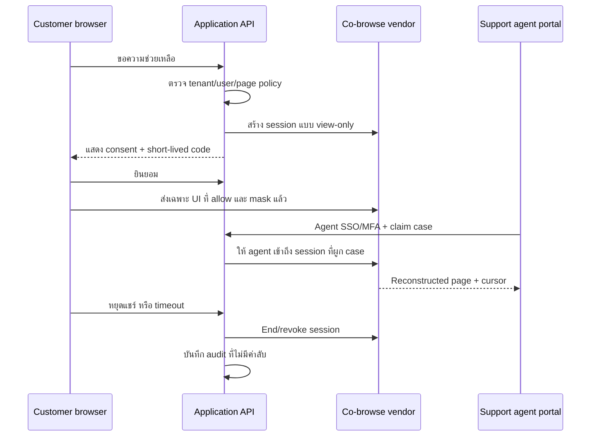

# Support Experience — Co-browsing plan

วันที่: 24 กันยายน 2026 · Change record: SC-2026-09-24-01

สถานะ: **Paused ตามคำขอผู้ใช้วันที่ 8 ตุลาคม 2026** หลังส่งมอบ shortlist, threat review, synthetic application-control harness ใน [docs/44](44-cobrowsing-vendor-discovery-and-synthetic-poc.md) และ [local consent/masking/view-only test surface](45-cobrowsing-local-poc-surface.md) ยังไม่ได้เลือกหรือซื้อ vendor, ฝัง SDK, เปิดข้อมูลจริง หรือรับรอง production/privacy/compliance งานเดิมเก็บไว้เพื่อกลับมาดำเนินการภายหลัง

## 1. เป้าหมายและขอบเขต

ให้ทีม Support เห็นหน้าเว็บเดียวกับลูกค้าและชี้แนะนำได้เมื่อผู้ใช้ขอความช่วยเหลือ โดยลูกค้าต้องยินยอมและหยุดได้ตลอดเวลา เริ่มเฉพาะหน้า own-origin ของแพลตฟอร์มในโหมด view-only ไม่ใช่ remote desktop และเจ้าหน้าที่ไม่ทำธุรกรรมแทนลูกค้า

ไม่อยู่ใน pilot แรก: remote control, full-device/tab screen sharing, session recording, การส่งภาพหรือ transcript ให้ AI, การเปิดไฟล์ Statement ดิบ และการดูข้าม tenant

## 2. ลำดับส่งมอบ

| งาน | ผลลัพธ์ | Dependency | Exit gate |
|---|---|---|---|
| SUPPORT-01 — Discovery + vendor PoC | ทดลองอย่างน้อย 2 provider ด้วย synthetic tenant และ support console จำลอง | Identity/audit baseline | Vendor matrix, threat review และ SUP-T01–10 บน PoC; ไม่มี production data |
| SUPPORT-02 — View-only pilot | รหัสใช้ครั้งเดียว, consent, cursor/highlight, page allowlist, masking, stop/timeout และ audit | SUPPORT-01, REL-AG-01, DEC-09 | ผู้ใช้และ Support UAT; tenant isolation/masking regression ผ่าน; feature flag + kill switch |
| SUPPORT-03 — Enterprise controls | Service-desk integration, SCIM/custom roles, SIEM, residency/retention/self-host/SLA ตามลูกค้า | SUPPORT-02, ENT-AG-01 และ requirement จริง | Security/DR/vendor review และ contract-specific UAT ผ่านก่อนขาย |

SUPPORT-01 ทำคู่ขนานได้เมื่อไม่แย่งงาน P0 ปัจจุบัน แต่ SUPPORT-02 ไม่เริ่มก่อน production identity, private data lifecycle, monitoring และ incident ownership ใน REL-AG-01 พร้อม

## 3. Vendor evaluation

Shortlist เริ่มต้น:

- [Cobrowse.io](https://cobrowse.io/product): SDK/API สำหรับเว็บและ mobile, private-by-default/redaction และตัวเลือก self-host
- [Unblu](https://www.unblu.com/en/platform/co-browsing): เน้น regulated/financial services, embedded/rendered Co-browsing และ deployment options
- [Genesys Co-browse](https://www.genesys.com/capabilities/co-browse-screenshare): ใช้พิจารณาเมื่อเลือก Genesys เป็น contact center หลัก
- [Surfly](https://www.surfly.com/security-and-compliance): ใช้เปรียบเทียบเมื่อมี use case เว็บภายนอกหรือ proxy-based collaboration

PoC ต้องเปรียบเทียบจากการทดลองจริง ไม่ตัดสินจาก feature list อย่างเดียว:

- Next.js/React dynamic UI, modal, virtualized table, iframe/canvas/PDF และการเปลี่ยน route
- ภาษาไทย, Thai IME, mobile Safari/Chrome, network หลุดและ reconnect
- Masking ของ input/text/table ที่เพิ่มแบบ dynamic และหลักฐานว่าค่าถูกปกปิดไม่ออกจาก browser
- Tenant/page/origin scope, code expiry/replay, concurrent session และ agent revocation
- SSO/MFA/SCIM, signed webhooks, audit/SIEM, recording-off และ retention/delete/export
- Hosting region, subprocessor, self-host/private deployment, SLA/incident process และ vendor exit
- ราคาแบบ agent/concurrent/session/MAU, support overhead และต้นทุนต่อ resolved case จาก workload ที่ทดลอง

## 4. Target architecture

`SupportSession` มีอย่างน้อย: tenant/customer/case/agent IDs, vendor session ID, hashed short code, mode, allowed origins/pages, consent/start/expiry/end times, end reason และ policy version

Vendor adapter รับผิดชอบ `createSession`, `claimSession`, `endSession` และ signed/idempotent webhook verification ส่วน authorization, tenant boundary, case assignment, consent record, policy และ audit เป็นความรับผิดชอบของระบบเรา

## 5. Privacy และ security defaults

- SDK เริ่มทำงานเมื่อผู้ใช้เปิด flow และ policy อนุญาตเท่านั้น; แสดง banner และปุ่มหยุดตลอด session
- Mask ก่อนข้อมูลออกจากเครื่อง: password/OTP/API key/token, cookie/local storage, payment/bank data, PII, raw Statement/file content, hidden DOM/state และ tenant navigation
- Agent เป็น identity แยก ใช้ SSO/MFA, least privilege, case assignment และเวลาเข้าถึงจำกัด; short code ไม่ใช่ authorization เพียงอย่างเดียว
- เปลี่ยน tenant/origin หรือเข้า page class ที่มีความเสี่ยงสูงต้องจบ session หรือขอ consent/scope ใหม่
- ไม่เก็บ recording ใน pilot; audit เก็บ metadata ที่จำเป็นโดยไม่เก็บค่าที่ mask มี per-tenant kill switch และ global incident kill switch
- AI ไม่เข้าร่วม session ใน pilot หากเพิ่มสรุปภายหลังต้องใช้ข้อมูลที่ลดรูปแล้ว พร้อม consent, retention, model/data policy และ human review แยก

## 6. Acceptance cases

| ID | กรณี | Expected |
|---|---|---|
| SUP-T01 | ไม่ยินยอมหรือปิด modal | ไม่มี SDK session/ข้อมูล UI ส่งให้ agent |
| SUP-T02 | Code หมดอายุ ใช้ซ้ำ หรือ agent/case ไม่ตรง | ปฏิเสธและ audit โดยไม่เปิดเผย tenant/user data |
| SUP-T03 | Agent ของ Tenant A พยายามเปิด session ของ B | Deny ทุก API/vendor claim; ไม่มี metadata ของ B |
| SUP-T04 | หน้า password/OTP/token/bank/Statement และ dynamic field | ค่าจริงไม่ออกจาก browser และไม่ปรากฏใน log/recording |
| SUP-T05 | ลูกค้าหยุดแชร์ logout หรือ membership ถูกถอน | session ถูก revoke ทันทีตามขอบเขตที่ทดสอบ และ reconnect ไม่คืนสิทธิ์เดิม |
| SUP-T06 | สลับ tenant/เปิด origin หรือหน้าที่ไม่ allow | หยุดหรือขอ consent ใหม่; ไม่แชร์ต่อเงียบ ๆ |
| SUP-T07 | Agent พยายาม click/type/submit ใน view-only | ไม่มีผลใน browser ลูกค้าและไม่มี business command ถูกเรียก |
| SUP-T08 | Vendor webhook ซ้ำ ปลอมลายเซ็น หรือมาสลับลำดับ | verify/dedup; state และ audit ไม่ย้อนหรือเพิ่มซ้ำ |
| SUP-T09 | ปิด feature flag/kill switch ระหว่าง session | ไม่เริ่ม session ใหม่; session ที่ active ถูกยุติตาม runbook |
| SUP-T10 | mobile/Thai IME/network reconnect | หน้าใช้งานต่อได้ ไม่มีข้อมูล mask กระพริบหรือหลุดระหว่าง reconnect |

## 7. ตัวชี้วัด pilot

วัดเวลาแก้ปัญหา, first-contact resolution, abandonment, CSAT และต้นทุนต่อเคส เทียบกับเคสชนิดเดียวกันก่อนใช้ Co-browsing รายงานจำนวน consent/reject/stop/timeout แยกจากผลสำเร็จ และตั้งเป้าด้าน privacy ว่าไม่มี known masking failure หรือ cross-tenant exposure ก่อนขยาย tenant

## 8. Decision boundary

หลัง SUPPORT-01 จึงตัดสิน DEC-09 เรื่อง vendor, hosting/region, shared page classes, recording/retention และ service-desk integration แผนนี้ไม่ให้สิทธิ์ซื้อบริการ ส่งข้อมูลจริงให้ vendor เปิด recording/control หรืออ้าง compliance การเปิดแต่ละ tenant ใช้ feature flag และ privacy/security/UAT evidence ของรุ่นนั้น
