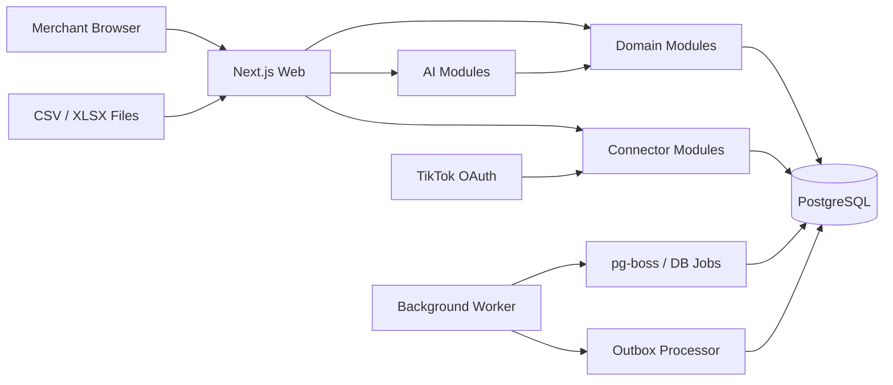
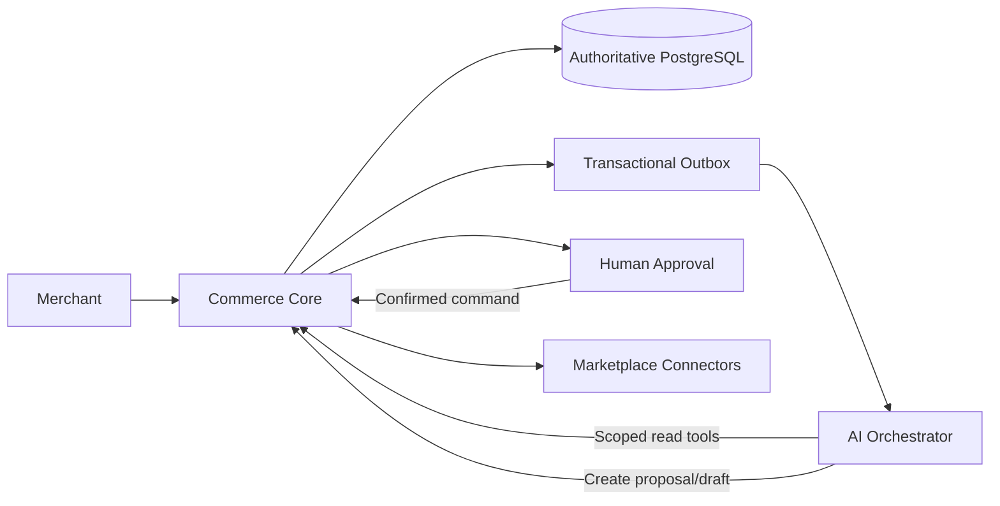

# Stock Management Project — Current System Assessment

วันที่ประเมิน: 13 พฤศจิกายน 2026
Repository snapshot: branch `main`, commit `cf24084`
ขอบเขต: ตรวจสอบ Source Code, SQL migrations, configuration, tests และเอกสารสถานะใน repository เท่านั้น

## สถานะที่ใช้ในรายงาน

- **Completed** — มี implementation ใน repository สำหรับขอบเขตปัจจุบัน ไม่ได้หมายถึงผ่าน Production UAT
- **Partial** — มีโครงสร้างหรือ workflow บางส่วน แต่ยังไม่ครบ end-to-end
- **Not Implemented** — ไม่พบ implementation ใน Source Code ที่ตรวจสอบ
- **Not Verified** — ไม่สามารถยืนยันจาก Source Code หรือ configuration ใน repository ได้

## 1. Executive Summary

ระบบปัจจุบันเป็น **Modular Monolith แบบ TypeScript monorepo** มี Web Application และ Background Worker แยก process แต่ใช้ PostgreSQL ชุดเดียวกัน ระบบมีรากฐานที่ดีสำหรับการพัฒนาเป็น AI Commerce Operations Platform ได้แก่:

- Product, SKU และ Product Variants แบบไม่ผูกกับประเภทสินค้า
- สต็อกกลาง, Stock Ledger, Reservation และ Manual/Shadow Orders
- Multi-Tenant, Shop-level access, RBAC และ PostgreSQL RLS
- Financial import/reconciliation และหลักฐานย้อนหลัง
- Transactional Outbox, Integration Inbox และ Service Principal
- AI แบบ read-only พร้อม bounded tools, evidence และ audit
- Human confirmation workflow สำหรับงานตรวจสอบการเงิน

ระบบยังอยู่ในระดับ **Staging Demo / Local Synthetic Pilot** และยังไม่พร้อมเปิด Production SaaS เพราะ Production mode ถูกบล็อกในโค้ดจนกว่าจะมี Production Identity และ Private Evidence Storage ที่ผ่านการตรวจรับ ดู [`packages/operations/src/index.ts`](../packages/operations/src/index.ts#L52)

ข้อจำกัดหลักในปัจจุบัน:

- TikTok Shop มีเพียง OAuth/Seller Authorization foundation ยังไม่อ่าน Order API จริง
- Shopee และ Lazada รองรับไฟล์ Statement แบบ synthetic adapter แต่ยังไม่เชื่อม API จริง
- มีโครงสร้าง inventory location แต่ workflow ปัจจุบันใช้คลังหลักเพียงแห่งเดียว
- ยังไม่มี Purchase Order, Supplier Management, Billing/Subscription และระบบแจ้งเตือนสต็อกอัตโนมัติ
- Live AI ถูกปิดใน Staging
- Production Identity, MFA, SSO/SCIM, invitation และ identity lifecycle ยังไม่มี
- ไฟล์หลักฐานยังเก็บเป็น binary ใน PostgreSQL

แนวทางที่เหมาะสมที่สุดคือ **C. Hybrid Architecture**: ให้ Core Commerce, Inventory, Tenant, Approval และ Audit อยู่ในระบบเดิม และค่อยแยก AI orchestration/runtime ออกเป็น service เมื่อเริ่มมี agent workload จริง โดย AI ต้องเข้าถึง Core ผ่าน API/Tools ที่มี scope และไม่เชื่อมฐานข้อมูลโดยตรง

## 2. Technology Stack

### Frontend

| รายการ | สิ่งที่ตรวจพบ |
|---|---|
| Framework | Next.js `16.3.5` |
| UI library | React และ React DOM `19.3.0` |
| Language | TypeScript `6.0.3` |
| Routing | Next.js App Router |
| Rendering | Server Components, Client Components และ Server Actions |
| Styling | Global CSS และ Noto Sans Thai; ไม่พบ Tailwind หรือ component framework ภายนอก |
| Testing | Vitest `5.0.1`, Playwright `1.63.0` |

อ้างอิง: [`package.json`](../package.json#L40), [`apps/web/next.config.ts`](../apps/web/next.config.ts#L1)

### Backend

Backend ใช้ **Node.js + TypeScript** โดยไม่มี Express, NestJS หรือ Fastify:

- HTTP API ใช้ Next.js Route Handlers ภายใต้ `apps/web/app/api`
- Server-side UI เรียก domain packages โดยตรง
- Background Worker เป็น Node/TypeScript process แยก
- Validation ใช้ Zod `4.6.5`
- โครงสร้างเป็น npm workspaces ประกอบด้วย `apps/*` และ `packages/*`

Node runtime ที่กำหนดคือ `>=22 <25` และ Render ใช้ `22.20.0` ดู [`package.json`](../package.json#L10) และ [`render.yaml`](../render.yaml#L17)

### Database

- PostgreSQL 17 บน Render
- `pg` เป็น database driver หลัก
- Drizzle ORM `0.45.2` ถูกใช้เป็น transaction/query wrapper
- Schema และ business constraints ส่วนใหญ่เขียนด้วย Raw SQL migrations และ PostgreSQL functions
- มี schema แยกเป็น `app`, `private` และ `jobs`
- ใช้ RLS, composite tenant keys, stored procedures และ advisory locks

อ้างอิง: [`packages/db/src/index.ts`](../packages/db/src/index.ts#L1), [`packages/db/migrations/0001-foundation.sql`](../packages/db/migrations/0001-foundation.sql#L1), [`render.yaml`](../render.yaml#L61)

### Authentication

ปัจจุบันเป็น **Custom Authentication สำหรับ Local/Staging Demo**:

- Email/password
- Password hash ด้วย Node `scrypt`
- Opaque session token แบบสุ่ม 32 bytes
- เก็บเฉพาะ SHA-256 hash ของ session token
- Session อายุ 8 ชั่วโมง
- Login rate limiting และ block 15 นาทีหลังพยายามผิดหลายครั้ง
- Session อยู่ใน `HttpOnly`, `SameSite=Lax`, Secure cookie บน HTTPS

อ้างอิง: [`packages/domain/src/auth.ts`](../packages/domain/src/auth.ts#L5), [`apps/web/app/actions.ts`](../apps/web/app/actions.ts#L9)

Production Authentication ยังไม่มี โดย `identityPool()` ปฏิเสธการทำงานนอก `local-demo` และ `staging-demo` ดู [`packages/db/src/index.ts`](../packages/db/src/index.ts#L10)

### Authorization

ระบบมี authorization หลายชั้น:

- Tenant membership
- Shop grants
- RBAC: `owner`, `finance`, `operator`, `marketing`, `auditor`
- PostgreSQL Row-Level Security
- Tenant และ actor context ผ่าน transaction-local PostgreSQL settings
- Domain-level role checks
- Origin validation สำหรับ mutation API
- Operational kill switches สำหรับ web mutations และ import commits

Role และ tenant schema อยู่ใน [`0001-foundation.sql`](../packages/db/migrations/0001-foundation.sql#L18) และ transaction context อยู่ใน [`packages/db/src/index.ts`](../packages/db/src/index.ts#L16)

### Hosting / Deployment

ใช้งาน Render Blueprint:

- Render Web Service
- Render Background Worker
- Render Managed PostgreSQL 17
- Region: Singapore
- Auto deploy เมื่อ checks ผ่าน
- Health check: `/api/health`
- Staging mode: `staging-demo`
- Live AI ปิดด้วย `AI_ENABLED=false`

อ้างอิง: [`render.yaml`](../render.yaml#L1)

ยังไม่พบ Production deployment configuration ที่ใช้งานได้จริง เพราะ production gate ถูกกำหนดให้ fail จนกว่าจะมี identity และ storage ที่ผ่านเกณฑ์

### Background Jobs, Queue และ Scheduled Tasks

| ความสามารถ | สถานะ |
|---|---|
| Background Worker | มี |
| PostgreSQL queue | มี |
| `pg-boss` | มี |
| Import commit jobs | มี เป็น DB-polled queue พร้อม retry |
| Transactional Outbox processor | มี |
| Worker heartbeat | มี ทุก 15 วินาที |
| Retry/backoff | มี |
| Dead-letter/error state | มีใน outbox/import workflow |
| Cron/Scheduled business jobs | ไม่พบ |
| Reservation expiry scheduler | ไม่พบ; มี transition รองรับแต่ต้องถูกเรียก |
| Marketplace polling/token refresh schedule | ยังไม่มี |

Worker ใช้ `pg-boss` สำหรับ `catalog-check` และใช้ polling loop สำหรับ import/outbox ดู [`apps/worker/src/index.ts`](../apps/worker/src/index.ts#L13) และ [`apps/worker/src/index.ts`](../apps/worker/src/index.ts#L90)

ไม่พบ Render Cron Job ใน [`render.yaml`](../render.yaml#L1) การใช้ `setInterval` และ polling loop ใน worker ไม่ถือเป็น business scheduler ที่มี durable schedule

## 3. Current Feature Status Matrix

### สถานะภาพรวมของแพลตฟอร์ม

| กลุ่มฟีเจอร์ | สถานะ | สิ่งที่ตรวจพบ |
|---|---|---|
| Tenant, Shop, RBAC, RLS | Completed สำหรับ Local/Staging | มี tenant/shop grants, roles และ isolation tests |
| Production Identity | Not Implemented | ยังเป็น demo password identity ไม่มี MFA/SSO/SCIM/invitation |
| Product/SKU lifecycle | Completed | เพิ่ม แก้ไข archive/restore และ variant attributes |
| Channel listing mapping | Completed สำหรับ manual flow | mapping ต่อร้านได้ แต่ยังไม่ verify/sync กับ Marketplace |
| Order/Sales file import | Completed สำหรับ synthetic flow | CSV/XLSX, mapping, checksum, duplicate handling, background commit |
| Marketplace Statement adapters | Partial | มี TikTok/Shopee/Lazada adapters แต่ยังรอไฟล์จริงและ finance sign-off |
| Financial reconciliation | Completed สำหรับ local synthetic | settlement, unmatched, refund, expense และ evidence |
| Financial AI review | Partial | tool-preview และ mocked/live boundary มีแล้ว แต่ Live AI/UAT ยัง pending |
| Inventory ledger | Completed สำหรับคลังหลัก | on-hand, reserved, available, movements |
| Inventory reservations | Completed สำหรับ manual/shadow flow | reserved/shortage/commit/release/expire |
| Commerce orders | Partial | manual/shadow order lifecycle; ยังไม่มี Order API/webhook จริง |
| Stock distribution | Partial | Shared/Fixed/Hybrid planning มีแล้ว แต่ยังไม่ write back |
| Outbox/Inbox/Event processing | Completed สำหรับ internal/synthetic | provider-specific webhook ยังไม่มี |
| TikTok OAuth | In Progress | authorization/token vault พร้อม แต่ยังไม่อ่านร้านและออเดอร์ |
| Production readiness | In Progress / NO-GO | identity, storage, monitoring ownership และ UAT ยังไม่ครบ |
| First merchant pilot | Not Started | backlog ระบุ Planned |
| Billing/Subscription | Not Implemented | ไม่พบ schema, route หรือ package |
| Public API/MCP | Not Started | backlog ระบุ Planned |
| Autonomous marketplace writes | Not Started | backlog ระบุ Planned |
| Payment/Checkout | Not Started | backlog ระบุ Pending input |
| Enterprise SSO/SCIM/SIEM | Not Started | มีเพียงแผนและ gap assessment |

อ้างอิงสถานะโครงการ: [`docs/04-backlog.md`](04-backlog.md#L11)

### Existing Stock Management Capabilities

| ความสามารถ | สถานะ | รายละเอียด |
|---|---|---|
| Product / SKU / Product Variants | **Completed** | Product กลาง, SKU unique ต่อ tenant, attributes แบบ JSON และ variants หลายรายการ |
| Inventory Balance | **Completed** | มี `on_hand`, `reserved`, `available` และ version ต่อ SKU/location |
| Stock Movement | **Completed** | opening, receipt, adjustment in/out และ sale commit; append-only ผ่าน DB functions |
| Multiple Warehouses | **Partial** | schema รองรับหลาย location แต่ application สร้างและอ่านเฉพาะ default `MAIN` |
| Purchase Orders | **Not Implemented** | ไม่พบ PO schema, domain service, API หรือ UI |
| Sales Orders | **Partial** | มี manual/shadow orders, payment/fulfillment states และ reservations แต่ยังไม่รับออเดอร์จริงจาก Marketplace |
| Sales History | **Partial** | มี imported `sales_lines`, financial summary และ shadow orders แต่ข้อมูลยังมาจาก file/manual และแยกเป็นสอง model |
| Product Cost | **Completed สำหรับ MVP** | มี effective-dated cost versions และ cost snapshot ใน import; ยังไม่มี landed cost หรือ supplier costing |
| Selling Price | **Completed สำหรับ MVP** | เก็บราคาและ currency ต่อ variant; ยังไม่มี channel price history หรือ writeback |
| Supplier Management | **Not Implemented** | ไม่พบ supplier schema/API/UI |
| Inventory Reports | **Partial** | มีหน้าสต็อกกลาง, status filters, movement history, reservations และ distribution view; ยังไม่มี valuation, aging, turnover หรือ replenishment report |
| Stock Alerts | **Partial** | ระบบระบุ shortage, out-of-stock และ reservation exception ได้ แต่ยังไม่มี threshold/reorder rule, notification channel หรือ scheduled evaluator |

อ้างอิง Product/SKU: [`0001-foundation.sql`](../packages/db/migrations/0001-foundation.sql#L41)
อ้างอิง Inventory Balance: [`0030-inventory-stock-ledger.sql`](../packages/db/migrations/0030-inventory-stock-ledger.sql#L18)
อ้างอิง Default Warehouse: [`0030-inventory-stock-ledger.sql`](../packages/db/migrations/0030-inventory-stock-ledger.sql#L84)
อ้างอิง Cost Versions: [`0001-foundation.sql`](../packages/db/migrations/0001-foundation.sql#L66)

หน้าสต็อกกลางรวมทุก SKU และช่องทางที่เกี่ยวข้อง พร้อม on-hand/reserved/distributable อยู่ใน [`centralInventoryOverview`](../packages/domain/src/index.ts#L385) แต่ `publishedQuantity` และ `syncedAt` ยังคืนค่า `NULL` เพราะยังไม่ได้ sync Marketplace ดู [`packages/domain/src/index.ts`](../packages/domain/src/index.ts#L430)

### ระดับการใช้งานจริง

ระบบสามารถใช้เพื่อ:

- Internal demo และ merchant workflow walkthrough
- Staging UAT ด้วยข้อมูลสมมติ
- จัดการสินค้า, SKU, ต้นทุน, manual inventory และ shadow orders
- นำเข้า CSV/XLSX และทำ financial reconciliation
- ทดสอบ tenant isolation, approval และ event architecture

ระบบยังไม่ควรใช้เป็น Production System of Record สำหรับร้านจริง เนื่องจาก:

1. Production identity ถูกบล็อก
2. หลักฐานไฟล์ยังเก็บใน PostgreSQL
3. Marketplace data ยังไม่ได้ตรวจรับจริง
4. Stock ไม่ได้ sync กลับ Marketplace
5. ยังไม่มี production backup/monitoring/SLA ที่ยืนยันแล้ว
6. Staging แสดงชัดว่าเป็นข้อมูลสมมติ ดู [`apps/web/lib/environment.ts`](../apps/web/lib/environment.ts#L25)

เอกสารล่าสุดระบุว่า test 31 files/210 cases และ production build เคยผ่าน ณ 22 ตุลาคม 2026 ดู [`docs/63-tiktok-shop-seller-authorization.md`](63-tiktok-shop-seller-authorization.md#L46) แต่ไม่ได้รัน test suite ใหม่ในการประเมินนี้ จึงถือว่าสถานะ test ปัจจุบันเป็น **Not Verified independently**

## 4. Existing Architecture

ระบบเป็น **Modular Monolith ที่แยก Web และ Worker runtime**:

Packages ที่แยกความรับผิดชอบ ได้แก่:

- `contracts`
- `db`
- `domain`
- `imports`
- `finance`
- `ai`
- `connectors`
- `integrations`
- `operations`
- `storage`
- `support`

ระบบไม่ใช่ monolith ก้อนเดียว แต่ยังไม่ใช่ Microservices เพราะใช้ repository เดียว, deploy Web/Worker จาก codebase เดียวกัน, share domain packages และใช้ PostgreSQL เดียว

Business invariants หลายส่วนอยู่ใน PostgreSQL functions เช่น inventory mutation, order transition, service principal และ approval workflow ซึ่งช่วยเรื่อง transaction consistency แต่เพิ่ม coupling กับ PostgreSQL และทำให้ migration มีความซับซ้อน

## 5. Multi-Tenant Readiness Assessment

| คำถาม | ผลประเมิน |
|---|---|
| รองรับหลายบริษัทหรือหลายร้านหรือไม่ | **รองรับ** |
| มี Tenant/Organization ID หรือไม่ | มี `tenant_id` |
| ข้อมูลแยกอย่างไร | Shared database/shared schema แยกด้วย `tenant_id`, composite FK, RLS และ transaction context |
| ผู้ใช้เข้าถึงหลายบริษัทได้หรือไม่ | ได้ ผ่าน memberships และ organization switcher |
| ผู้ใช้เข้าถึงหลายร้านได้หรือไม่ | ได้ หาก `all_shops=true` หรือมี `shop_grants` |
| มี RBAC หรือไม่ | มี 5 roles |
| มี Subscription/Billing หรือไม่ | ไม่มี |
| Enterprise identity | ไม่มี |
| Dedicated tenant/database | ไม่มี |
| Tenant quota/rate plans | ไม่มีในเชิง Subscription; AI มี run quota บางส่วนแต่ไม่ใช่ commercial plan |

Tenant context ถูกกำหนดต่อ transaction ผ่าน `app.actor_id` และ `app.tenant_id` ดู [`packages/db/src/index.ts`](../packages/db/src/index.ts#L16) ผู้ใช้สามารถเปลี่ยน organization และ shop ได้ผ่าน server actions ที่ตรวจ membership/grant ก่อน ดู [`apps/web/app/actions.ts`](../apps/web/app/actions.ts#L17)

### จุดแข็ง

- tenant ID อยู่ใน business tables
- composite foreign key ลดโอกาสเชื่อมข้อมูลข้าม tenant
- RLS เป็น defense-in-depth
- role ถูกตรวจใหม่ทุก transaction
- shop-level grants
- มี cross-tenant integration tests เช่น [`tests/foundation.test.ts`](../tests/foundation.test.ts#L11)

### จุดที่ยังไม่พร้อมสำหรับ SaaS เต็มรูปแบบ

- ไม่มี signup, invite, password reset, MFA และ identity lifecycle
- ไม่มี SSO, SCIM หรือ enterprise directory
- ไม่มี tenant billing, plan, entitlement และ usage metering เชิงพาณิชย์
- ไม่มี tenant-level data retention/residency policy
- ไม่มี noisy-neighbor controls หรือ per-tenant workload quota
- ไม่พบ tenant offboarding/export/delete workflow

Migration `0044` เปลี่ยน application tables เป็น `NO FORCE ROW LEVEL SECURITY` เพื่อรองรับ managed database owner และ SECURITY DEFINER functions ดู [`0044-managed-database-owner-rls.sql`](../packages/db/migrations/0044-managed-database-owner-rls.sql#L1) Runtime roles ยังคงเป็น non-owner และต้องผ่าน RLS แต่การแยก admin/runtime credentials จึงเป็น security-critical control

## 6. API & Integration Readiness

### API รูปแบบปัจจุบัน

มี **REST-like JSON API** ผ่าน Next.js Route Handlers ไม่พบ GraphQL, OpenAPI หรือ Swagger

API หลักที่ตรวจพบ:

- Catalog และ Product
- Inventory และ Inventory Reservation
- Inventory Distribution
- Listing Mapping
- Orders mutation
- Imports และ source evidence
- Financial events, expenses, settlements
- AI analysis และ settlement review
- Financial review drafts/tasks
- Members และ Shops
- Integration Inbox
- Service Principals
- TikTok authorization/callback
- Health และ Readiness

### Read API Coverage

| ข้อมูล | API สำหรับอ่าน |
|---|---|
| Products/Catalog | มี `GET catalog` และ `GET product detail` |
| Inventory/Stock | มี `GET inventory` และ `GET inventory-distribution` |
| Orders | ไม่มี generic `GET /orders`; หน้า Orders อ่าน domain service โดยตรง |
| Sales History | ไม่มี external/public Sales GET API ที่ชัดเจน |
| Financial Summary | UI/server-side domain read เป็นหลัก |
| Organizations/Shops | มี GET |
| Marketplace connections | UI/domain read; ไม่พบ public versioned connector API |

ระบบมี internal application API แต่ยังไม่ถือเป็น **Public Commerce API** สำหรับ AI service หรือ third party เพราะไม่มี API versioning, OpenAPI contract หรือ external developer lifecycle และหลาย read workflow เรียก domain package โดยตรง

### Marketplace Integrations

#### TikTok Shop

มีแล้ว:

- Seller authorization URL
- Signed OAuth state อายุ 10 นาที
- Token exchange
- รับเฉพาะ seller token
- AES-256-GCM token encryption
- Tenant/shop-scoped connection metadata
- Owner-only authorization
- Development/Production environment guard

อ้างอิง: [`packages/connectors/src/index.ts`](../packages/connectors/src/index.ts#L29), [`packages/connectors/src/index.ts`](../packages/connectors/src/index.ts#L100)

ยังไม่มี:

- Get Authorized Shops
- การผูก `shop_cipher` กับร้านจริง
- Order List/Detail ingestion
- Webhook จริง
- Token refresh scheduler
- Rate-limit handling ที่ตรวจรับกับ provider
- Inventory/price/fulfillment writeback

สถานะระบุชัดว่า “ยังไม่อ่าน Order API” ใน [`docs/63-tiktok-shop-seller-authorization.md`](63-tiktok-shop-seller-authorization.md#L1)

#### Shopee และ Lazada

- มี file adapters สำหรับ Statement
- มี automatic adapter detection
- มี CSV/XLSX parsing และ schema version
- ยังไม่พบ OAuth/API/Webhook connector จริง

#### Facebook

ไม่พบ Facebook Commerce, Meta Catalog หรือ Graph API integration ใน source ที่ตรวจสอบ

### Webhook และ Event System

ระบบมี event foundation:

- Transactional Outbox
- Per-consumer deliveries
- Retry และ lease
- Event receipt hash
- Integration Inbox
- HMAC verification
- Duplicate detection
- Sequence gap detection
- Replay request/acknowledgement
- Service Principal พร้อม tenant/shop/scope/expiry

Service Principal รองรับ scopes เช่น `integration:ingest`, `integration:read`, `outbox:publish` ดู [`0040-service-principals.sql`](../packages/db/migrations/0040-service-principals.sql#L121)

Generic ingestion function ยังไม่เท่ากับ provider webhook endpoint จริง เพราะไม่พบ public HTTP route ที่รับ TikTok/Shopee webhook และ normalize provider payload โดยตรง

## 7. AI Integration Readiness

### AI/LLM ที่มีอยู่

ระบบมี AI integration แล้ว:

- Vercel AI SDK `ai 7.0.102`
- `ToolLoopAgent`
- AI Gateway model selection
- Zod tool schemas
- Step limit 3
- Timeout 45 วินาที
- Token/cost recording
- Workflow/prompt/tool/policy versions
- AI run history และ quota
- Evidence-backed responses
- Prompt-injection instruction boundary

Catalog AI มีเพียง tool อ่าน catalog และไม่มี mutation tool ดู [`packages/ai/src/index.ts`](../packages/ai/src/index.ts#L20)

Financial review AI ใช้ structured output ตรวจว่า exception ID ที่ AI เลือกมีอยู่ในหลักฐานจริง และปฏิเสธคำตอบที่ไม่ตรง evidence ดู [`packages/ai/src/settlement-review.ts`](../packages/ai/src/settlement-review.ts#L113)

Live AI ถูกปิดใน Render Staging ดู [`render.yaml`](../render.yaml#L15)

### AI Agent Framework

มี agent framework ระดับ workflow ผ่าน `ToolLoopAgent` แต่ยังไม่มี:

- Multi-agent orchestration
- Durable agent state machine
- Marketing Agent หรือ Inventory Agent
- General tool registry
- Long-term memory/vector store
- Agent-to-agent communication
- Production AI evaluation gate ที่ผ่าน human sign-off
- Tenant-level model/provider policy
- Enterprise AI data residency controls

### AI Chat Interface

มีหน้า `/ai` และ AI workspace อยู่แล้ว ดู [`apps/web/app/(workspace)/ai/page.tsx`](../apps/web/app/(workspace)/ai/page.tsx#L1)

การเพิ่ม chat แบบ conversation ทำได้ไม่ยากในเชิง UI แต่ backend ต้องเพิ่ม:

- Thread/message persistence
- Tool scopes ต่อ role/tenant/shop
- Context window policy
- PII and sensitive-data filtering
- Prompt-injection defenses ต่อ tool
- Approval boundary สำหรับ mutation
- Cost/rate limits ต่อ tenant
- Retention/deletion policy

### AI เรียก Backend อย่างปลอดภัยได้หรือไม่

**รองรับบางส่วน**

สิ่งที่มีแล้ว:

- Tool ปัจจุบันปิดอยู่ภายใน authenticated tenant context
- ตรวจ shop grants
- Read-only tools
- Bounded steps
- Evidence validation
- AI run audit
- Service Principal สำหรับ machine access

สิ่งที่ยังขาด:

- Versioned Agent Tool API
- Fine-grained tool authorization policy registry
- Per-tool rate limit
- Purpose/consent policy
- General approval engine สำหรับ inventory/marketing actions
- Short-lived delegated agent credentials
- Safe idempotency contract สำหรับ external writes
- Revocation/circuit-breaker ต่อ agent หรือ tenant

AI service ในอนาคตไม่ควรเข้าฐานข้อมูลโดยตรง และไม่ควรนำ domain functions ไป expose เป็น tool โดยอัตโนมัติ

### Audit Log และ Approval Workflow

มี audit log กลางใน `app.audit_events` ดู [`0001-foundation.sql`](../packages/db/migrations/0001-foundation.sql#L73)

Financial review มี workflow:

1. AI/ระบบสร้าง draft
2. Draft เก็บ evidence hash และ payload hash
3. ผู้ใช้ยืนยัน
4. ระบบตรวจ stale/expired/changed evidence
5. สร้าง task ที่มี `approved_by` และ `executed_by`
6. เก็บ audit event

Migration ระบุชัดว่าโมเดลสามารถเสนอ draft ได้ แต่ยืนยันเองไม่ได้ ดู [`0022-financial-review-tasks.sql`](../packages/db/migrations/0022-financial-review-tasks.sql#L266)

Approval นี้ยังเป็น domain-specific สำหรับ financial review ไม่ใช่ approval framework กลางสำหรับ Marketing/Inventory Agents

## 8. Technical Risks

### ความเสี่ยงระดับสูง

1. **Production identity ยังไม่มี**
   Custom password authentication ถูกจำกัดไว้สำหรับ demo/staging และไม่มี MFA, SSO, SCIM, invitation หรือ lifecycle ที่เหมาะกับ SaaS

2. **Marketplace integration ยังไม่ครบ closed loop**
   ระบบยังไม่รับ order/webhook จริงและไม่ sync stock กลับ จึงยังไม่สามารถรับประกัน stock accuracy ระหว่างแพลตฟอร์มได้

3. **Order/Sales มีสอง model**
   มีทั้ง imported `sales_lines` และ `commerce_orders` หากเชื่อม Marketplace จริงต้องกำหนด canonical order model และ reconciliation rule ให้ชัด

4. **Inventory รองรับเพียง default warehouse ใน workflow**
   แม้ schema มี location แต่ query และ mutation ใช้ default location การเพิ่ม multi-warehouse จริงต้องเพิ่ม transfer, location selection, reservation allocation และ reporting

5. **ไม่มี scheduler สำหรับงาน Marketplace**
   Token refresh, periodic order reconciliation, stock alert evaluation และ reservation expiry ยังไม่มี durable scheduled workflow

6. **ไม่มี Billing/Entitlement**
   Multi-Tenant foundation มีแล้ว แต่ยังไม่สามารถควบคุม plan, usage, quota และ feature entitlement ต่อ tenant

### Security Risks

- Managed DB owner สามารถ bypass RLS ได้โดยธรรมชาติ ต้องรักษาการแยก admin/runtime credential อย่างเข้มงวด
- Token encryption ใช้ key version `v1` แต่ยังไม่พบ token encryption key rotation workflow
- Global Next headers มี `nosniff`, frame denial, referrer policy และ no-store แต่ไม่พบ CSP หรือ Permissions-Policy ใน app config ดู [`next.config.ts`](../apps/web/next.config.ts#L9)
- HSTS ที่อาจถูกเพิ่มโดย Render เป็น **Not Verified**
- ยังไม่มี production secret-manager integration ที่ตรวจรับแล้ว
- ยังไม่มี AI privacy/data-processing policy ที่นำไปใช้จริง

### Performance และ Scalability

- Web, Worker, Identity, Queue และ business data พึ่ง PostgreSQL cluster เดียว
- Web pool จำกัด 8 connections และ identity pool 3 connections ดู [`packages/db/src/index.ts`](../packages/db/src/index.ts#L6)
- Render staging ใช้ instance 0.5 CPU/512MB
- File bytes ยังอยู่ใน PostgreSQL ทำให้ database โตเร็ว ดู [`packages/storage/src/index.ts`](../packages/storage/src/index.ts#L24)
- ไม่พบ load test, capacity benchmark หรือ tenant concurrency benchmark จึงเป็น **Not Verified**
- Polling loops ทำงานได้ในขนาดเล็ก แต่ควรประเมินใหม่เมื่อจำนวน tenant/event สูงขึ้น

### Operational Risks

- Production backup/PITR/external backup เป็นเพียงข้อเสนอ ยังไม่ยืนยันการเปิดใช้งาน
- Monitoring scripts มี แต่ไม่พบ external production monitoring/on-call ที่ใช้งานจริง
- ไม่มี provider sandbox validation ครบวงจร
- ไม่มี production disaster recovery evidence
- ไม่มี current merchant UAT sign-off
- Support co-browsing ถูกพักไว้และยังไม่มี vendor SDK

### Technical Debt ก่อน AI Agents เขียนข้อมูล

- สร้าง canonical Agent Tool/API contract
- ทำ approval framework กลาง
- รวม canonical order/event model
- เพิ่ม durable scheduler
- แยก evidence file storage ออกจาก PostgreSQL
- ทำ production identity adapter
- เพิ่ม billing/entitlement boundary
- เพิ่ม multi-warehouse domain หากอยู่ใน product scope
- ทำ provider reconciliation และ token lifecycle
- เพิ่ม observability ด้วย trace ID ที่ไหลผ่าน Web → Outbox → Worker → Connector → AI run

## 9. Recommended Architecture Approach

### เปรียบเทียบแนวทาง

| แนวทาง | ข้อดี | ข้อเสีย/ผลกระทบ |
|---|---|---|
| **A. AI Module ใน Application เดิม** | เริ่มเร็ว ใช้ domain functions และ transaction เดิมได้ง่าย deployment ไม่ซับซ้อน | AI latency และ failure กระทบ Web, scale แยกไม่ได้, เสี่ยงให้ agent เข้าถึง domain/database มากเกินไป |
| **B. AI Service แยกทั้งหมด** | scale แยกได้, isolate model/provider failure, deploy AI workflow แยกจาก Core | ต้องสร้าง API และ distributed security จำนวนมากทันที, เพิ่ม network failure, duplicated contracts, operational cost สูง |
| **C. Hybrid Architecture** | รักษา Core เป็น system of record แต่แยก AI runtime เมื่อเหมาะสม ใช้ outbox/inbox และ approval เดิมได้ | ต้องวาง boundary และ versioned contracts ให้ดี มี complexity มากกว่า A เล็กน้อย |

### คำแนะนำ: C. Hybrid Architecture

ระบบมี foundation สำหรับ Hybrid อยู่แล้วจาก:

- Modular packages
- Web/Worker separation
- Service Principals
- Transactional Outbox
- Integration Inbox
- Audit log
- Human confirmation workflow
- Read-only AI tools

### ขอบเขตที่ควรอยู่ใน Core Application

- Tenant, User, Role และ Shop grants
- Product/SKU
- Inventory ledger และ reservation
- Orders และ financial records
- Approval state
- Audit
- Idempotency
- Marketplace connection metadata
- Outbox transaction

### ขอบเขตของ AI Service ในอนาคต

- Conversation/thread orchestration
- Marketing Agent
- Inventory Planning Agent
- Model routing
- Prompt/tool versioning
- Evaluation
- Long-running agent workflow
- AI cost controls
- Non-authoritative memory/embeddings

AI Service ควรเรียก Core ผ่าน scoped API/tool gateway เท่านั้น:

### แนวทางแบบเป็นระยะ

1. **ระยะปัจจุบัน**
   รักษา AI ใน monorepo แต่จำกัดเป็น read/analyze/propose และกำหนด tool contracts ให้เป็น versioned interfaces

2. **ก่อนเพิ่ม AI Marketing/Inventory Team**
   สร้าง Agent Tool Gateway สำหรับ catalog, inventory, orders, finance และ campaign data พร้อม scope, rate limit, audit และ evidence

3. **แยก AI runtime**
   แยกเมื่อมี conversation state, concurrent agents, long-running workflows หรือความต้องการ scale ที่ต่างจาก Web

4. **Mutation ผ่าน proposal เท่านั้น**
   Agent สร้าง draft/plan แล้ว Core ตรวจ current state, permission, idempotency และ human approval ก่อน execute

5. **Marketplace write ผ่าน connector command**
   ห้าม AI เรียก Marketplace โดยตรง ให้ Core ออก command ผ่าน Outbox และ Connector Worker จากนั้นรับผลกลับผ่าน Inbox/Reconciliation

แนวทางนี้ใช้ทรัพย์สินที่มีอยู่แล้วได้มากที่สุดและลดความเสี่ยงจากการแยกระบบเร็วเกินไป

## 10. Open Questions / Missing Information

1. TikTok Partner registration และ scopes ผ่าน review แล้วหรือยัง — **Not Verified จากระบบภายนอก**
2. Credentials บน Render ถูกตั้งครบและใช้งานได้จริงหรือไม่ — **Not Verified**
3. ได้ทดสอบ Get Authorized Shops/Order API กับ Development Shop จริงหรือยัง — จาก source ระบุว่ายังไม่ทำ
4. ไฟล์ Statement จริงของ TikTok/Shopee/Lazada ผ่าน finance sign-off แล้วหรือยัง
5. Canonical order จะใช้ `commerce_orders` หรือรวมกับ imported `sales_lines` อย่างไร
6. ต้องรองรับคลังหลายแห่ง, bin, lot, serial, expiry date หรือ transfer หรือไม่
7. Purchase Order, supplier, receiving และ landed cost อยู่ใน scope ระยะแรกหรือไม่
8. Stock alert หมายถึงแจ้งของหมด, reorder point, forecast หรือ anomaly
9. AI Inventory Agent สามารถเสนออย่างเดียวหรืออนุญาตให้สั่งซื้อ/ปรับ stock/writeback
10. AI Marketing Agent ต้องเข้าถึง TikTok Ads API, content, campaign budget และ customer dataระดับใด
11. Production identity provider ที่จะอนุมัติใช้จริง
12. Billing model: ต่อร้าน, ต่อ tenant, ต่อ order, ต่อ AI usage หรือ hybrid
13. เป้าหมายจำนวน tenant, shops, SKU, orders/day และ events/second
14. SLA, RPO, RTO และ data residency สำหรับ Enterprise
15. นโยบาย AI data retention, model provider และการใช้ข้อมูลลูกค้า
16. Production object storage, encryption key ownership และ retention policy
17. Current test/build status ของ commit ล่าสุด — มีผลการทดสอบเดิมในเอกสาร แต่ไม่ได้รันยืนยันใหม่ใน assessment นี้

## Assessment Boundary

ข้อค้นพบทั้งหมดในรายงานนี้อ้างอิงจาก Source Code และ Configuration ที่มีอยู่ใน repository ณ commit ที่ระบุ ไม่ได้ตรวจสอบ dashboard หรือข้อมูล runtime ของผู้ให้บริการภายนอก และไม่มีการแก้ Source Code, ติดตั้ง package, เปลี่ยน Database Schema, Deploy หรือเริ่มพัฒนา AI Commerce OS ระหว่างการประเมิน
