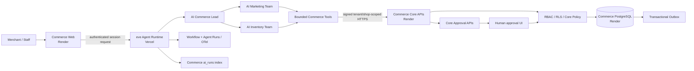

# eve Agent Runtime บน Vercel — Architecture Decision และ POC Plan

วันที่ตัดสินใจ: 13 พฤศจิกายน 2026
สถานะ: **Approved architecture direction; EVE-POC-01–11 ผ่านในขอบเขต synthetic/non-live**

เอกสารนี้บันทึกการตัดสินใจใช้ eve เป็น runtime เป้าหมายสำหรับ AI Commerce Lead, AI Marketing Team และ AI Inventory Team โดย deploy แยกบน Vercel ส่วน Stock Management Web Application, Commerce Core, PostgreSQL, workers, RBAC, RLS, inventory ledger, financial reconciliation, transactional outbox และ business rules ยังคงอยู่บน Render

การอนุมัติทิศทางนี้ครอบคลุม compatibility spike และ Vercel non-production runtime foundation แล้ว โดยมี source แยกใน `apps/agent-runtime` และ deployment เฉพาะ Preview ที่ปิด live AI ไม่มี Commerce credential/data/tool และปฏิเสธ Vercel Production ตั้งแต่ build/runtime gate ดูผลตรวจ [EVE-POC-02](67-eve-vercel-runtime-foundation.md) ยังไม่อนุมัติ production, live model, production account, direct database access หรือ Commerce mutation

## Decision

เลือก **Hybrid deployment with shared contracts and isolated agent runtime**:

- source ของ agent runtime อยู่ใน monorepo เดิมเพื่อใช้ TypeScript contracts, evidence schemas และ release controls ร่วมกัน
- eve runtime เป็น Vercel deployment แยกจาก Next.js Commerce Web บน Render
- agent เรียก Commerce Core ผ่าน signed HTTPS API ที่จำกัด tenant, shop, role และ scope
- agent runtime ไม่มี Commerce database credential และไม่เรียก PostgreSQL โดยตรง
- financial และ inventory mutations ต้องผ่าน Core Approval และ Policy APIs
- legacy Vercel AI SDK `ToolLoopAgent` คงอยู่จนกว่า POC, shadow และ canary gates ผ่าน

เหตุผลที่เลือก Vercel สำหรับ eve คือ deployment target นี้มี managed Workflow, Sandbox และ Agent Runs ตามเส้นทางหลักของ framework ลดภาระ Postgres Workflow World, callback routing และ sandbox operation ที่ต้องจัดการเองหาก self-host บน Render ดู [eve deployment](https://eve.dev/docs/guides/deployment) และ [self-hosting](https://eve.dev/docs/guides/deployment/self-hosting)

## Deployment boundary



Trust boundary ที่บังคับใช้:

1. eve เป็น orchestration และ recommendation runtime ไม่ใช่ system of record
2. tenant identity มาจาก server-verified authentication ห้ามให้ prompt หรือ model เลือก tenant
3. Core re-authorize ทุก tool request แม้ eve ตรวจ scope แล้ว
4. eve approval เป็น interaction consent ไม่แทน Core authorization หรือ business approval
5. tool output ส่งเฉพาะข้อมูลที่ลดรูปและมี evidence reference ไม่ส่ง credential, raw statement หรือ PII ที่ไม่จำเป็น
6. ทุก write ใช้ proposal, policy version, evidence hash, expiry และ idempotency key ก่อน Core execution

## Runtime compatibility constraints

- eve source ปัจจุบันระบุ Node.js `>=24`; Render Commerce services ปัจจุบันยังใช้ Node `22.20.0` จึงไม่ embed eve ใน web service เดิม
- eve รองรับ Next.js `^16` และ React `^19` แต่ exact dependency combination ของ repository ต้องพิสูจน์ใน POC
- eve ยังเป็น release candidate ในเวลาที่ประเมิน ต้อง pin exact version ห้ามใช้ floating `latest`
- Vercel Agent Runtime และ Render Commerce Core ต้องใช้ region ที่วัด latency แล้วและผ่าน data policy
- หากใช้ Vercel Workflow/Agent Runs ต้องกำหนด retention, redaction, environment separation และ cost owner ก่อนใช้ข้อมูลร้านจริง

ผล compatibility spike วันที่ 13 พฤศจิกายน 2026 ยืนยันว่า eve ใช้ร่วมกับ monorepo ได้เมื่อแยก Node 24 และ agent-local AI SDK ออกจาก Commerce runtime ชุดที่ผ่านคือ `eve 1.0.0-rc.10`, Node `24.22.3`, AI SDK `7.0.137`, Next `16.4.6`, React `19.3.0`, TypeScript `6.0.3` และ Zod `4.6.7` ดูหลักฐานและข้อจำกัดใน [EVE-POC-01](66-eve-compatibility-spike.md)

## Target agent teams

### AI Commerce Lead

ประสานงาน Marketing และ Inventory, รวมผลที่มีหลักฐาน, ตรวจ conflict ระหว่างโอกาสขายกับ stockout risk และไม่มี direct mutation tool

### AI Marketing Team

- Marketing Strategy Agent
- Ads Optimization Agent
- Content Marketing Agent
- Sales Analytics Agent

### AI Inventory Team

- Stock Monitoring Agent
- Demand Forecast Agent
- Replenishment Agent
- Inventory Audit Agent

POC แรกใช้เพียง Commerce Lead, Marketing Analysis และ Inventory Analysis อย่างละหนึ่งตัวก่อน ไม่เปิด agent ทั้งเก้าตัวพร้อมกัน

## Proposed source layout

```text
apps/
  web/                         # existing Render web
  worker/                      # existing Render worker
  agent-runtime/               # future Vercel eve deployment
    agent/
      instructions.md
      agent.ts                 # Commerce Lead
      subagents/
        marketing-analysis/
        inventory-analysis/
      tools/
      instrumentation/
      auth/
packages/
  agent-contracts/             # request/result/evidence schemas
  commerce-agent-client/       # signed Core API client
  agent-evidence/              # evidence envelope, hash and validation
  ai/                          # legacy ToolLoopAgent during migration
```

EVE-POC-02 สร้าง `apps/agent-runtime` แล้ว และ EVE-POC-03 สร้าง `packages/agent-contracts` แล้ว ส่วน client/evidence package จะสร้างเมื่อ transport และรูปแบบหลักฐานต้องแยกใช้จริง ไม่สร้าง package เปล่าไว้ล่วงหน้า

## Non-production POC

คำถามตัวอย่าง:

> Which products should we promote next week without creating stockout risk?

POC ต้องมี:

- Commerce Lead หนึ่งตัว
- Marketing Analysis และ Inventory Analysis อย่างละหนึ่งตัว
- synthetic tenant อย่างน้อยสอง tenant
- read-only Product, Sales และ Inventory APIs
- evidence reference, as-of time, data version และ limitations ทุก recommendation
- cross-tenant isolation tests รวม forged tenant ID และ prompt injection
- trace ที่เชื่อม root run, child agents, model calls และ tools
- token/cost summary ต่อ tenant/run
- restart/retry test และ rollback rehearsal
- ไม่มี production marketplace, live AI account หรือ mutation tool

## POC backlog และ acceptance criteria

| ID | งาน | เกณฑ์ผ่าน |
|---|---|---|
| EVE-POC-01 | Version/dependency spike | **Conditional pass** — Node 24 build ผ่านด้วย eve version ที่ pin; compatibility, security baseline และ license inventory อยู่ใน [docs/66](66-eve-compatibility-spike.md) |
| EVE-POC-02 | Vercel runtime foundation | **Pass** — health, OIDC, Workflow session resume ข้าม Preview deployment และ environment separation ผ่าน; live AI ถูกบล็อกที่ route ดู [docs/67](67-eve-vercel-runtime-foundation.md) |
| EVE-POC-03 | Core Agent API contracts | **Pass** — read-only Product/Sales/Inventory v1 schemas มี bounds, trusted scope, evidence/version, pagination และ safe errors; transport ยังปิด ดู [docs/68](68-commerce-agent-read-api-contracts.md) |
| EVE-POC-04 | Service authentication | **Pass** — unsigned, bad signature, stale/replay, expired/revoked, wrong audience/environment/shop/scope และ caller-supplied tenant ถูกปฏิเสธ; ดู [docs/69](69-agent-service-authentication.md) |
| EVE-POC-05 | Commerce Lead delegation | **Pass** — Lead เรียก specialist สองตัว, revalidate กับ Core และรวม structured result โดยไม่สร้าง fact ใหม่ ดู [docs/70](70-eve-commerce-lead-delegation.md) |
| EVE-POC-06 | Cross-tenant isolation | **Pass แบบ create-only session** — signed scope/RLS/API/cursor/evidence/cache/session isolation ผ่าน; continuation ปิดจนมี Core session registry ดู [docs/71](71-eve-cross-tenant-isolation.md) |
| EVE-POC-07 | Evidence-backed recommendation | **Pass แบบ synthetic read-only** — pinned snapshot, hash/source/scope resolver, evidence manifest/completeness และ stockout constraint ผ่าน ดู [docs/72](72-eve-evidence-backed-recommendation.md) |
| EVE-POC-08 | Durability/idempotency | **Pass แบบ synthetic read-only** — stable execution/request identity, exact replay และ write-once Core result ผ่าน failure injection ดู [docs/73](73-eve-durability-and-idempotency.md) |
| EVE-POC-09 | Observability and cost | **Pass แบบ synthetic metadata-only** — root/children/tools/Core/evidence link, no-content OTel/Agent Runs redaction และ provider usage/cost attribution ผ่าน ดู [docs/74](74-eve-tracing-redaction-cost-attribution.md) |
| EVE-POC-10 | Shadow comparison | **Pass แบบ synthetic system comparison** — 3 shared cases, eve correctness/grounding 3/3, no stockout/mutation failure และ legacy user-visible ดู [docs/75](75-eve-legacy-shadow-comparison.md); live model metrics ยัง pending |
| EVE-POC-11 | Rollback rehearsal | **Pass แบบ synthetic read-only** — default legacy, explicit per-tenant allowlist, global kill switch และ fallback-once เมื่อ unavailable/timeout/operator rollback; 6/6 ผ่าน, Commerce mutation 0 ดู [docs/76](76-eve-rollback-rehearsal.md) |
| EVE-CANARY-01 | Read-only canary readiness | **Review complete / BLOCKED** — technical evidence 7/7, approvals 0/6; machine-readable gate และ gaps อยู่ใน [docs/77](77-eve-read-only-canary-readiness.md) |
| EVE-CANARY-02 | Dynamic tenant routing control | **Pass แบบ synthetic/staging และ disabled by default** — Owner proposal + Auditor approval, optimistic concurrency, append-only audit, expiry/revoke และ transactional grant lock ผ่าน; ดู [docs/78](78-eve-dynamic-tenant-routing-control.md) |
| EVE-CANARY-03 | Canary monitoring and incident rehearsal | **Pass แบบ synthetic engineering rehearsal** — metadata-only tenant window, machine-readable non-approved thresholds, signed alert, kill switch และ recovery ผ่าน; SLO/provider/incident owners ยังรออนุมัติ ดู [docs/79](79-eve-canary-monitoring-incident-rehearsal.md) |
| EVE-CANARY-04 | Approval decision pack and staging runbook | **Complete / execution BLOCKED** — monitor/SLO options, ownership matrix, machine gate, evidence template และ abort/recovery runbook พร้อม ดู [docs/80](80-eve-canary-approval-decision-pack.md) และ [docs/81](81-eve-canary-staging-execution-runbook.md) |
| EVE-CANARY-05 | Live-turn policy adapter and negative security harness | **Complete / runtime disabled** — staging/tenant/shop/role/session/model/window/budget policy และ negative tests ผ่าน; ยังไม่ใส่ model key ไม่ deploy และ canary ยัง blocked ดู [docs/82](82-eve-live-turn-policy-security-harness.md) |
| EVE-CANARY-06 | One-time grant consumption and active-grant revocation | **Complete / runtime disabled** — Core-owned atomic registry, replay/concurrency/isolation rejection และ route/individual revoke ผ่าน ดู [docs/83](83-eve-one-time-grant-registry.md) |
| EVE-CANARY-07 | Grant retention, telemetry and abuse controls | **Complete / runtime disabled** — fixed retention, metadata-only tenant metrics, grant thresholds, shared rate limit และ bounded worker cleanup ผ่าน ดู [docs/84](84-eve-grant-operations.md) |

POC exit gate ต้องผ่าน isolation 100%, ไม่มี direct database access, ไม่มี mutation tool, evidence completeness 100% ใน critical cases และ restart/rollback rehearsal ผ่าน จึงเสนอ read-only canary ได้

## Migration sequence

1. **POC:** synthetic, read-only, Vercel non-production project
2. **Shadow:** legacy และ eve รับ input ชุดเดียวกัน แต่ผู้ใช้ยังเห็นผลจาก legacy
3. **Read-only canary:** จำกัด internal user/test tenant และมี kill switch
4. **First vertical:** ย้ายเฉพาะคำแนะนำโปรโมตสินค้าโดยคุม stockout risk
5. **Proposal workflow:** agent สร้างข้อเสนอผ่าน Core API; คนยืนยันใน Commerce UI
6. **Team expansion:** เพิ่ม agent ทีละตัวหลัง eval/security/UAT ผ่าน

ไม่มีการย้าย Commerce data, ledger, RLS, tenant หรือ outbox เข้า eve Workflow Store ส่วน `app.ai_runs` ยังคงเป็น business-facing run index และผูก eve session/trace ID ใน production phase ภายหลัง

## Rollback

- route ด้วย tenant-scoped feature flag
- legacy ToolLoopAgent คงอยู่ไม่น้อยกว่าหนึ่ง release cycle หลัง canary
- ปิด Vercel Agent Runtime ได้โดย Commerce Core, stock และ finance ยังทำงานต่อ
- recommendation/proposal ที่ยังไม่ยืนยันยกเลิกได้
- Core transaction ที่ยืนยันแล้ว rollback/compensate ตาม business workflow เดิม ไม่ย้อนด้วย eve
- ก่อนอัปเกรด eve ต้องหยุด session ใหม่, drain งาน, archive trace mapping และ canary รุ่นใหม่

## Production gates ที่ยังไม่อนุมัติ

- production identity provider และการนำ service credential ไปเก็บ/หมุนใน Vercel Production; non-production authentication contract ผ่าน EVE-POC-04 แล้ว
- `recommendation:create` และ `approval-proposal:create` ยังไม่ออกแบบ; read scopes ถูกบังคับใน service principal/database policy แล้ว
- Product/Sales/Inventory route handlers, rate limit และ OpenAPI; HTTP signing/authentication tests พร้อมแล้วใน EVE-POC-04
- data residency, retention, DPA และ trace redaction policy
- model/provider allowlist, budget และ rate limits ต่อ tenant
- approver matrix และ separation of duties
- incident owner, SLO, kill switch และ cost alerts
- live marketplace data และ mutation tools

## Go / No-Go

**Go:** ทำ isolated POC บน Vercel ตาม backlog EVE-POC-01–11 หลังได้รับอนุมัติ implementation รอบถัดไป

**No-Go:** ยังไม่แทน legacy runtime, ไม่เปิด production data/account, ไม่ให้ eve ต่อ Commerce PostgreSQL และไม่เปิด financial/inventory mutation จนกว่า Core Agent API, policy, approval, isolation, durability และ rollback gates ผ่าน
