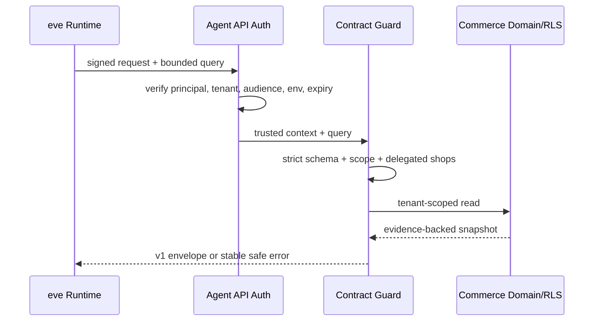

# EVE-POC-03 — Read-only Commerce Agent API Contracts

วันที่ตรวจรับ: 13 พฤศจิกายน 2026
สถานะ: **Complete — shared contracts only; transport remains closed**

## ผลลัพธ์

เพิ่ม package [`@commerce/agent-contracts`](../packages/agent-contracts/src/index.ts) เป็นสัญญากลางระหว่าง eve Agent Runtime บน Vercel กับ Commerce Core บน Render สำหรับการอ่าน Product, Sales และ Inventory โดยยังไม่เพิ่ม public route, service credential, database query หรือ tool ให้ agent เรียกใช้งานจริง

การแยก contract ออกจาก transport ทำให้งาน EVE-POC-04 สามารถเพิ่ม service authentication ก่อนเปิด endpoint ได้ ระบบจึงไม่เกิดช่วงที่ API ใหม่เปิดโดยไม่มี tenant/shop authorization

## Contract boundary

| Operation | Method/path ที่จองไว้ | Scope ที่ต้องมี | Bound หลัก |
|---|---|---|---|
| `products.query` | `POST /api/agent/v1/products/query` | `catalog:read` | ร้าน ≤ 20, SKU filter ≤ 100, ผล ≤ 100, search ≤ 100 ตัวอักษร |
| `sales.query` | `POST /api/agent/v1/sales/query` | `sales:read` | ร้าน ≤ 20, ช่วงเวลา ≤ 93 วัน, SKU filter ≤ 100, ผล ≤ 100 |
| `inventory.query` | `POST /api/agent/v1/inventory/query` | `inventory:read` | ร้าน ≤ 20, SKU filter ≤ 100, ผล ≤ 100, channel allocation ≤ 20 ต่อ SKU |

`POST` ในที่นี้เป็น bounded query ที่ไม่มี mutation semantics เพราะ filter มีโครงสร้างซับซ้อน ทุก path อยู่ใต้ namespace `/api/agent/v1` และยัง **ไม่ถูก mount** ใน Next.js

## Trusted scope

Tenant ID ไม่อยู่ใน model/tool input schema และ request body ที่แอบส่ง `tenantId` ถูกปฏิเสธด้วย strict schema ตัว Core ต้องสร้าง `AgentRequestContext` จาก service identity ที่ตรวจแล้ว ซึ่งประกอบด้วย:

- tenant และ principal ID
- delegated shop IDs
- read scopes
- audience และ environment
- request ID
- authenticated/expiry timestamps

ฟังก์ชัน [`authorizeAgentQuery`](../packages/agent-contracts/src/index.ts) ตรวจ scope และยืนยันว่าร้านทุกแห่งใน query อยู่ใน delegation อีกชั้นหนึ่ง ฟังก์ชันนี้เป็น contract authorization เท่านั้น; การตรวจ signature/credential, expiry, audience และ environment แบบ request-time เป็นงาน EVE-POC-04



## Evidence and version semantics

ผลลัพธ์ทั้งสามชนิดต้องมี:

- `contractVersion = commerce-agent-read-v1`
- `requestId`, `asOf` และ `dataVersion`
- `isSynthetic` เพื่อไม่ให้ข้อมูลทดสอบถูกตีความเป็นข้อมูลจริง
- shop scope ที่ใช้สร้างผล
- cursor pagination ที่ `hasMore` และ `nextCursor` สอดคล้องกัน
- `limitations`
- evidence อย่างน้อยหนึ่งรายการต่อ item พร้อม kind, opaque reference, observed time, source version และ optional SHA-256

Product ส่งเฉพาะข้อมูลสินค้า/ราคาและร้านที่ลงขาย ไม่มีต้นทุน Sales ส่ง aggregate ต่อ variant/channel/day ไม่มีข้อมูลผู้ซื้อหรือ raw order Inventory ส่ง on-hand/reserved/available/safety stock/distributable และ policy/channel projection พร้อมตรวจ invariant:

```text
available = max(0, onHand - reserved)
distributable = max(0, available - safetyStock)
```

Response schema ปฏิเสธ item หรือ channel ที่อ้าง shop นอก response scope จึงลดโอกาสนำผลข้าม tenant/shop มารวมโดยไม่ตั้งใจ

## Error semantics

Public error envelope มี contract/request ID, stable code, safe message, retryable flag และ field issues ที่จำกัดขนาด ไม่อนุญาต stack trace หรือ key อื่นจากระบบภายใน Code ที่จองไว้ครอบคลุม invalid request, unauthenticated, expired identity, wrong audience/environment, missing scope, forbidden shop, rate limit, expired snapshot, not found และ internal error พร้อม mapping HTTP 400/401/403/404/409/429/500 และ retry policy แบบคงที่ การแปลง credential failure เป็น envelope นี้ที่ request-time จะทำใน EVE-POC-04

## Verification

ไฟล์ทดสอบ: [`tests/agent-contracts.test.ts`](../tests/agent-contracts.test.ts)

| Gate | ผล |
|---|---|
| TypeScript repository typecheck | Pass |
| ESLint package + contract tests | Pass |
| Contract tests | 6/6 pass |
| Repository integration suite | 216/216 pass |
| Commerce Web production build | Pass |
| eve Node 24 test/typecheck/local build | Pass; live AI remains disabled |
| Production dependency audit | Pass; 0 vulnerability |
| Query body ที่มี `tenantId` | Rejected |
| limit > 100 / ร้าน > 20 / sales period > 93 วัน | Rejected |
| scope หรือ delegated shop ไม่ตรง | Rejected |
| item/channel หลุด response shop scope | Rejected |
| ไม่มี evidence/version หรือ pagination ไม่สอดคล้อง | Rejected |
| inventory arithmetic ไม่สอดคล้อง | Rejected |
| error มี field แปลก เช่น stack | Rejected |

## สิ่งที่ยังไม่เปิด

- ยังไม่มี `/api/agent/v1/*` route บน Render
- ยังไม่ได้เพิ่ม read scopes ใน service principal database policy
- eve runtime ยังไม่มี Product/Sales/Inventory tools
- ไม่มี Commerce database credential ใน eve runtime
- ไม่มี live AI, production data, marketplace account หรือ mutation API
- ยังไม่ได้กำหนด HTTP signature/token format, replay protection, rate limit และ audit record

งานถัดไปคือ **EVE-POC-04 — Service-to-service authentication**: ขยาย service principal ให้รองรับ read scopes และตรวจ tenant/shop/audience/environment/expiry ที่ Core ก่อน mount endpoint จากนั้นจึงทำ transport-level contract/isolation tests

> อัปเดต 13 พฤศจิกายน 2026: EVE-POC-04 ผ่านแล้วตาม [service authentication report](69-agent-service-authentication.md) โดยยังไม่เปิด Commerce data routes งานถัดไปคือ EVE-POC-05
