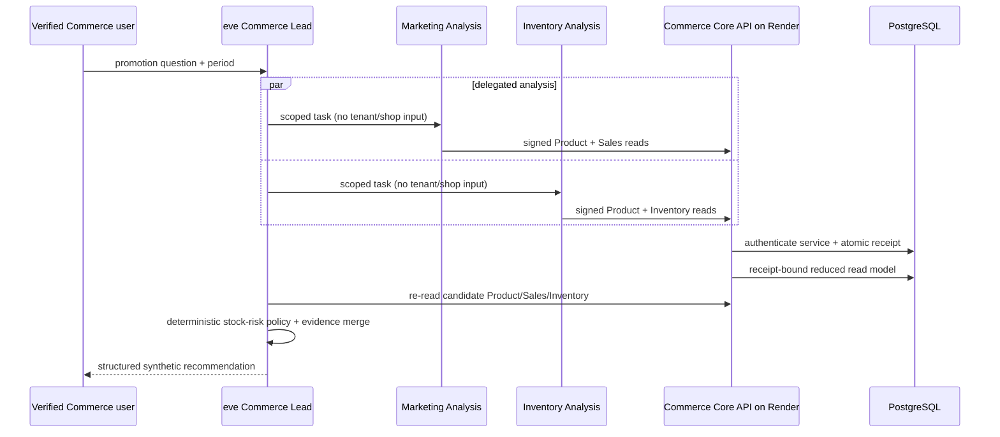

# EVE-POC-05 — Commerce Lead Delegation

วันที่ตรวจรับ: 13 พฤศจิกายน 2026
สถานะ: **Complete ในขอบเขต non-live synthetic POC; live model turn ยังถูกบล็อก**

## ผลลัพธ์

เพิ่มเส้นทาง read-only จาก eve ไปยัง Commerce Core และ Commerce Lead workflow สำหรับคำถามตัวอย่าง “ควรโปรโมตสินค้าใดสัปดาห์หน้าโดยไม่เสี่ยง stockout” โดยคง PostgreSQL ledger, tenant/RBAC/RLS, business rules และ mutation ทั้งหมดไว้ใน Core เดิม

Commerce Lead มอบหมายงานให้ specialist สองตัว:

- `marketing-analysis` อ่าน product/SKU และ sales aggregate เพื่อนำเสนอ candidate
- `inventory-analysis` อ่าน product/SKU และ central inventory/policy เพื่อประเมิน stockout risk

หลัง specialist ตอบ Lead จะอ่าน Product, Sales และ Inventory จาก Core ซ้ำใน durable workflow step แล้วสร้างผลรวมแบบ deterministic ข้อมูลตัวเลขและ evidence ในผลสุดท้ายจึงมาจาก response ที่ผ่าน schema ของ Core ไม่คัดลอก claim เชิงข้อเท็จจริงจากข้อความของ agent

## Architecture ที่ส่งมอบ

## Implementation references

| ส่วน | Code reference |
|---|---|
| Commerce Core routes | `apps/web/app/api/agent/v1/{products,sales,inventory}/query/route.ts` |
| Authentication + pagination + evidence response | `packages/agent-api/src/index.ts` |
| Purpose-built receipt-bound readers | `packages/db/migrations/0047-agent-read-models.sql` และ `packages/db/src/index.ts` |
| Signed TypeScript client | `packages/commerce-agent-client/src/index.ts` |
| Commerce Lead workflow | `apps/agent-runtime/agent/tools/analyze_promotion_candidates.ts` |
| Specialist agents/tools | `apps/agent-runtime/agent/subagents/marketing-analysis` และ `inventory-analysis` |
| Deterministic verification/consolidation | `apps/agent-runtime/agent/lib/promotion-analysis.ts` |
| Session scope และ tenant-bound client | `apps/agent-runtime/agent/lib/commerce-scope.ts`, `commerce-client.ts` |

## Security boundary

- tool schemas ไม่มี `tenantId` หรือ `shopIds`; ทั้งสองค่ามาจาก verified Eve session principal
- POC service credential ผูก `COMMERCE_AGENT_TENANT_ID` และ environment; mismatch หยุดก่อนส่งคำขอ
- Core หา tenant จาก credential ในฐานข้อมูล และตรวจ shop/scope/audience/environment/expiry ใหม่ทุก request
- read function ทำงานได้เมื่อมี receipt อายุไม่เกิน 5 นาทีที่ scope และ shop ตรงกันเท่านั้น
- projection ไม่คืน cost, supplier, customer, buyer, raw order identity หรือ database credential
- Sales คืน aggregate เท่านั้น; Inventory ระบุชัดว่า channel quantity เป็น planning value และ published quantity ยังไม่ทราบ
- ไม่มี mutation tool, approval bypass, marketplace write, schedule หรือ direct database connection จาก eve
- public error ใช้ stable safe code; internal SQL/stack ไม่ถูกส่งกลับ client

## Grounding policy

Specialist เลือก candidate และให้ signal เชิงวิเคราะห์ แต่ final output ใช้เฉพาะ candidate ที่:

1. อยู่ในผล Product read ที่ยืนยันซ้ำ
2. มี Inventory read และ specialist assessment ที่ product/variant/SKU ตรงกัน
3. ใช้ยอดขาย/สต็อก/evidence จาก Core response เท่านั้น

Stock risk ใน POC คำนวณแบบ deterministic: `distributable = 0` เป็น high; ถ้ามี safety stock และ distributable เหลือไม่เกิน safety stock เป็น medium; นอกนั้นเป็น low ถ้า child assessment ขัดกับ policy ผลจาก verified policy ถูกใช้และ limitation ระบุความขัดแย้ง

## Verification

- database migration ใช้ PostgreSQL/RLS จริงใน isolated database
- Product pagination ใช้ opaque query-bound cursor และรักษา `asOf`
- Inventory arithmetic, delegated channel scope และ evidence schema ผ่าน
- Sales response ไม่มี raw order/customer fields
- credential ของ Chino ใช้ shop ของ tenant อื่นไม่ได้
- helper ตรวจ receipt ไม่เปิด execute ให้ `commerce_app`
- deterministic consolidation ตัด invented variant ออก และบังคับ hold เมื่อ distributable เป็นศูนย์
- Node 24 typecheck/test และ `eve build` ผ่าน พบ root + specialists 2 ตัวและ workflow tool
- ชุดรวม: **34 test files, 227 tests ผ่าน**

`eve build` แจ้งว่า local machine ไม่มี Docker/Vercel sandbox provider สำหรับ default sandbox template แต่ build สำเร็จ และ POC นี้ไม่มี sandbox tool จึงไม่กระทบ read-only workflow

## ขอบเขตที่ยังปิด

- `COMMERCE_AGENT_LIVE_AI=false` และ channel ปฏิเสธ model turn ก่อน execution
- ยังไม่ใส่ Commerce service credential จริงใน Vercel Preview
- ยังไม่ได้ทดสอบ trace/cache/session leakage ข้าม tenant แบบ end-to-end; เป็น EVE-POC-06
- ยังไม่เปิด production, marketplace account, live data, mutation หรือ human approval command

> อัปเดตภายหลัง: EVE-POC-06 ผ่านแล้วตาม [cross-tenant isolation report](71-eve-cross-tenant-isolation.md) ด้วย Core-signed create grant, RLS/pinned scope และ cross-tenant API/cursor/evidence/cache/session tests งานถัดไปคือ EVE-POC-07
