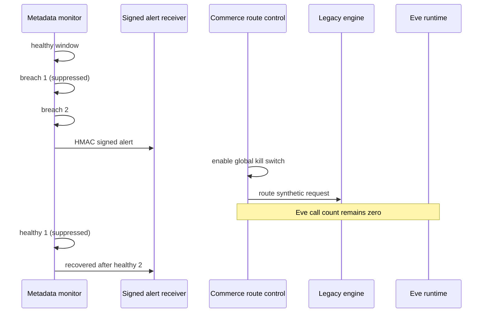

# EVE-CANARY-03 — Canary Monitoring, SLO and Incident Control Rehearsal

สถานะ: **Complete for synthetic engineering rehearsal; canary approval remains blocked** วันที่ 15 พฤศจิกายน 2026

## ผลลัพธ์

เพิ่มสัญญา monitor สำหรับ Eve canary ที่รับเฉพาะ metadata ของ route, session, fallback, error และ provider-reported cost พร้อมประเมินเป็นหน้าต่างต่อ tenant เกณฑ์ทดสอบอยู่ในไฟล์ machine-readable และระบุชัดว่าเป็น `engineering-rehearsal-only`, `not-approved` จึงไม่ใช่ SLO หรือ SLA ของระบบจริง

การซ้อม synthetic ผ่านลำดับ baseline healthy → breach สองรอบ → signed alert → global kill switch → recovery สองรอบ โดย kill switch ส่งงานกลับ legacy และไม่เรียก Eve runtime

Live AI, model key, production tenant, marketplace account, database mutation และการ deploy ไม่ถูกใช้ในงานนี้

## Monitoring contract

แต่ละ signal ต้องมี:

- UUID ของ event, execution และ tenant
- timestamp
- `contentCaptured: false`
- metadata ตามชนิด event ที่อยู่ใน allowlist เท่านั้น

Parser ปฏิเสธ field เพิ่มเติม เช่น prompt, message, tool payload, customer data หรือ error detail และ aggregator เลือกเฉพาะ signal ของ tenant และช่วงเวลาที่กำลังประเมิน

| Signal | Metadata ที่รับ |
|---|---|
| route | `legacy|eve`, bounded route reason |
| session | `started|completed` |
| fallback | เหตุผลจาก enum ที่กำหนด |
| error | stage และ safe error code จาก enum |
| cost | `reported|partial|unavailable` และ provider-reported USD หรือ `null` |

Cost ที่ provider ไม่รายงานจะไม่ถูกประดิษฐ์จาก rate card และมี counter `unavailableCostEvents` แยกต่างหาก

## Machine-readable rehearsal policy

[config/eve-canary-monitoring.json](../config/eve-canary-monitoring.json) กำหนด window, consecutive breach/recovery และ threshold สำหรับ automated rehearsal เท่านั้น ไฟล์บังคับสถานะต่อไปนี้เพื่อป้องกันการตีความผิด:

```json
{
  "classification": "engineering-rehearsal-only",
  "approvalStatus": "not-approved",
  "scope": "synthetic-tenant-only",
  "slo": { "status": "not-approved", "availabilityPercent": null },
  "incidentOwnership": { "status": "not-approved", "primaryOwner": null, "backupOwner": null }
}
```

ค่า rehearsal ใช้ยืนยัน logic และ alert transition เท่านั้น ผู้มีอำนาจต้องอนุมัติ monitor provider, availability SLO, alert evidence, primary/backup owner, acknowledgement target และ runbook ผ่าน `config/eve-canary-readiness.json` ก่อนเริ่ม canary window

## Control flow ที่ซ้อม



Alert delivery ใช้ exact-body `HMAC-SHA256` contract เดียวกับ Commerce runtime monitor พร้อม event ID และ timestamp การซ้อมตรวจลายเซ็นใน memory จึงเป็นหลักฐานของ contract ไม่ใช่หลักฐานว่า external alert provider หรือ human escalation ทำงานแล้ว

## Rehearsal evidence

[รายงานล่าสุด](evidence/eve-canary-incident-rehearsal-latest.json) ผ่านทุก check:

- baseline healthy และ signal ของ tenant อื่นไม่ถูกรวม
- breach รอบแรกถูก suppress; รอบที่สองสร้าง transition
- fallback, error และ reported cost threshold ถูกตรวจพบ
- signed alert ถูกตรวจ exact body และ signature
- kill switch เลือก legacy, legacy ถูกเรียกหนึ่งครั้ง และ Eve ถูกเรียกศูนย์ครั้ง
- recovery รอบแรกถูก suppress; รอบที่สองสร้าง transition
- serialized evidence ไม่มี content field ที่ห้าม

รันซ้ำได้ด้วย:

```sh
AI_ENABLED=false COMMERCE_AGENT_LIVE_AI=false npm run agent:canary:rehearse
```

Script ปฏิเสธ production mode และปฏิเสธเมื่อ live AI flag เปิด

## Code references

- `packages/operations/src/agent-canary-monitoring.ts` — signal allowlist, policy validation, tenant window evaluation, threshold และ transition
- `packages/operations/src/monitoring.ts` — shared exact-body signed alert delivery
- `config/eve-canary-monitoring.json` — synthetic rehearsal thresholds และ explicit non-approval state
- `scripts/rehearse-agent-canary-controls.ts` — deterministic breach/alert/kill-switch/recovery rehearsal
- `tests/agent-canary-monitoring.test.ts` — content rejection, tenant boundary, threshold, transition และ signature tests
- `docs/evidence/eve-canary-incident-rehearsal-latest.json` — machine-readable rehearsal evidence

## Verification

- Targeted monitoring tests: 8/8 ผ่าน
- TypeScript typecheck: ผ่าน
- ESLint: ผ่าน
- Synthetic incident-control rehearsal: ผ่านทุก check
- Live AI calls: 0
- Marketplace writes: 0
- Database mutations: 0

## ข้อจำกัดและ readiness decision

- ไม่มี durable telemetry ingestion/retention ที่อนุมัติสำหรับ production
- ไม่มี external alert delivery evidence หรือ human acknowledgement
- SLO, alert provider, incident primary/backup owner และ acknowledgement target ยังไม่อนุมัติ
- signed session grant ใช้ครั้งเดียว, route revoke ยกเลิก active grants และ operational telemetry/rate limit/retention พร้อมแล้วตาม [EVE-CANARY-06](83-eve-one-time-grant-registry.md)–[07](84-eve-grant-operations.md)
- approval gates ยัง 0/6 และ production ยังคง **NO-GO**

## งานถัดไปที่แนะนำ

**EVE-CANARY-04 — Canary approval decision pack and staging execution runbook** ส่งมอบแล้วใน [decision pack](80-eve-canary-approval-decision-pack.md) และ [runbook](81-eve-canary-staging-execution-runbook.md)

ขั้นวิศวกรรมถัดไปคือ **EVE-CANARY-05 — Live-turn policy adapter and negative security harness** แบบ disabled by default โดยยังไม่เพิ่ม model key หรือเปิด live canary
