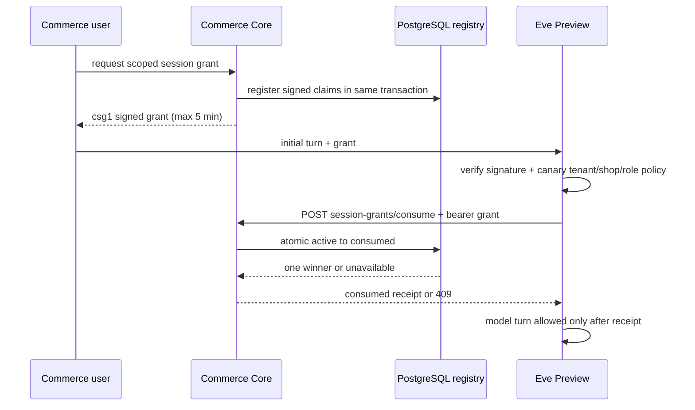

# EVE-CANARY-06 — One-time Grant Consumption and Active-grant Revocation

สถานะ: **Engineering complete / Live AI disabled / canary BLOCKED**
วันที่: 15 พฤศจิกายน 2026

## ผลลัพธ์

Commerce Core เป็นเจ้าของ durable session-grant registry ใน PostgreSQL และ Eve
ต้อง consume `grantId` ผ่าน Core ก่อนสร้าง initial model turn ทุกครั้ง การเปลี่ยน
สถานะ `active → consumed` ทำใน SQL statement เดียว จึงมีผู้ชนะได้เพียงคำขอเดียว
เมื่อเกิด retry หรือ concurrency

งานนี้ไม่ได้เปิด Live AI, ไม่เพิ่ม model key, ไม่ deploy และไม่เปลี่ยน business
inventory/finance rules

## Trust boundary



## Security properties

- Registry row ถูกสร้างพร้อม issuance audit ภายใน tenant transaction เดียว
- เก็บ claims ที่ใช้ตรวจ exact match: tenant, subject, shops, role, environment,
  issued/expires time และ signing key ID
- consume endpoint ตรวจ Ed25519 signature ก่อนแตะ registry
- replay, expired, revoked, claim mismatch และ cross-tenant lookup ตอบ generic 409
- route-policy revoke ยกเลิก active grants ของ tenant ใน transaction เดียว
- Owner/Auditor ยกเลิก grant รายตัวได้ผ่าน same-origin authenticated API
- ตารางเปิด RLS; runtime role ไม่มี direct UPDATE/DELETE
- Eve ไม่มี database credential และต้องได้รับ matching consume receipt ก่อนคืน auth context

## Code references

- `packages/db/migrations/0050-agent-session-grant-registry.sql` — registry,
  atomic transitions, RLS และ SECURITY DEFINER functions
- `packages/agent-session/src/index.ts` — register/verify/consume/revoke application flow
- `packages/db/src/index.ts` — DB adapters และ route-revoke cascade
- `apps/web/app/api/agent/v1/session-grants/consume/route.ts` — bearer consume endpoint
- `apps/web/app/api/tenants/[tenantId]/agent-session/[grantId]/revoke/route.ts` — human revoke endpoint
- `apps/agent-runtime/agent/lib/commerce-grant-consumer.ts` — bounded HTTPS consume call
- `apps/agent-runtime/agent/lib/commerce-canary-auth.ts` — consume before auth success/model call
- `tests/agent-session-grant-registry.test.ts` — replay, concurrency, revoke และ isolation
- `apps/agent-runtime/tests/commerce-canary-auth.test.ts` — consume receipt/replay enforcement

## Verification

```text
Agent test files        9/9 passed
Integration test files 41/41 passed
Integration tests      267/267 passed
TypeScript / ESLint    passed
```

ฐานข้อมูล integration test ถูกสร้างใหม่ชั่วคราวและ apply migrations ทั้งชุดจากศูนย์

## Limitations

1. existing Eve session continuation ยังปิด เพราะยังไม่มี Core-owned mapping ระหว่าง
   Eve session ID กับ user/tenant/shop สำหรับทุก follow-up
2. rate-limit/abuse telemetry ถูกเพิ่มแล้วใน [EVE-CANARY-07](84-eve-grant-operations.md)
3. retention cleanup ถูกเพิ่มแล้วใน [EVE-CANARY-07](84-eve-grant-operations.md)
4. staging provider, monitoring, alert delivery และ approvals ยังไม่พร้อม
5. การ consume สำเร็จแล้วแต่ Eve session creation ล้ม ต้องขอ grant ใหม่; ระบบตั้งใจ
   fail closed และไม่คืนสถานะ grant เป็น active

## งานถัดไปที่แนะนำ

**EVE-CANARY-07 — Grant registry retention, operational telemetry and abuse controls — Complete**

ผลส่งมอบอยู่ใน [docs/84](84-eve-grant-operations.md); งานถัดไปคือ EVE-CANARY-08
สำหรับ Core-owned session continuation registry และ per-session ACL
