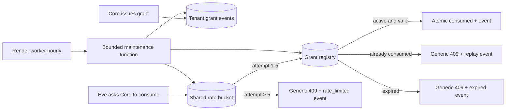

# EVE-CANARY-07 — Grant Retention, Telemetry and Abuse Controls

สถานะ: **Engineering complete / Live AI disabled / canary BLOCKED**
วันที่: 15 พฤศจิกายน 2026

## ผลลัพธ์

Commerce Core มี operational boundary สำหรับ session grants ครบวงจรแล้ว โดยบันทึก
เฉพาะ metadata ของเหตุการณ์ `issued`, `consumed`, `replay`, `revoked`, `expired`
และ `rate_limited` แยก tenant พร้อม RLS ไม่เก็บ token, prompt หรือ customer content

consume path ใช้ PostgreSQL fixed-window counter แบบ atomic จึงใช้ขีดจำกัดร่วมกัน
ระหว่างทุก Core instance ได้ ขีดจำกัด engineering canary คือ **5 attempts ต่อ exact
grant ต่อนาที** และทุก expected denial ยังคงตอบ generic unavailable เพื่อไม่เผยสถานะ grant

งานนี้ไม่ได้เปิด Live AI, ไม่เพิ่ม model key, ไม่ deploy และไม่เพิ่ม mutation tool

## Operational flow



## Fixed retention policy

| Data | Retention | เหตุผล |
|---|---:|---|
| Active grant ที่หมดอายุ | 7 วันหลัง `expires_at` | ใช้ตรวจเหตุผิดปกติระยะสั้นแล้วลด claims ที่เก็บไว้ |
| Consumed/revoked grant | 30 วันหลัง terminal timestamp | รองรับ incident correlation และ audit investigation |
| Operational event metadata | 90 วัน | ใช้วัดแนวโน้มโดยไม่เก็บ signed token/content |
| Rate-limit bucket | 1 วันหลังใช้งานล่าสุด | ป้องกันตาราง counter โตโดยไม่จำเป็น |

Worker เรียก maintenance ทุกหนึ่งชั่วโมง, จำกัดครั้งละ 500 แถว และใช้ advisory lock
เพื่อให้หลาย worker ไม่ทำ maintenance พร้อมกัน การเปลี่ยน retention/rate limit ต้องผ่าน
migration ใหม่ จึงไม่สามารถลด control ผ่าน environment variable โดยไม่ได้ review

## Metrics and alerts

- Owner/Auditor อ่าน tenant metrics ผ่าน
  `GET /api/tenants/{tenantId}/agent-session/metrics?windowMinutes=60`
- window จำกัด 1 นาทีถึง 7 วัน และผลตอบกลับมี `contentCaptured: false`
- synthetic monitoring policy แจ้ง breach เมื่อ replay มากกว่า 1, พบ rate-limit
  อย่างน้อย 1 หรือพบ grant หมดอายุโดยไม่ถูกใช้ อย่างน้อย 1 ในหน้าต่าง 5 นาที
- threshold เหล่านี้เป็น **engineering rehearsal / not approved** ไม่ใช่ production SLO
- signed alert contract และ consecutive breach/recovery behavior ยังใช้ร่วมกับ canary
  monitor เดิม

## Security properties

- rate counter อยู่ใน PostgreSQL ไม่ใช่ process memory
- exact signed claims ต้องตรงกับ registry ก่อนนับ attempt จึงไม่สร้าง cross-tenant event
  จาก caller-supplied tenant/grant ID
- lifecycle event ใช้ trigger และ unique indexes ป้องกัน issued/consumed/revoked/expired ซ้ำ
- rate-limit event มีได้หนึ่งรายการต่อ grant ต่อหนึ่งนาที ลด write amplification
- event table เปิด RLS และอนุญาตอ่านเฉพาะ Owner/Auditor ของ tenant
- maintenance เปิดให้เฉพาะ `commerce_queue` login role และใช้ fixed policy
- application แปลงเฉพาะ expected unavailable เป็น 409; database/infrastructure error ไม่ถูกซ่อน

## Code references

- `packages/db/migrations/0051-agent-session-grant-operations.sql` — telemetry,
  atomic rate limit, metrics และ retention maintenance
- `packages/db/src/index.ts` — tenant metrics adapter
- `packages/agent-session/src/index.ts` — Owner/Auditor metrics boundary และ fail-safe error mapping
- `apps/web/app/api/tenants/[tenantId]/agent-session/metrics/route.ts` — authenticated metrics API
- `apps/worker/src/index.ts` — hourly bounded maintenance
- `packages/operations/src/agent-canary-monitoring.ts` — grant signal contract และ alert thresholds
- `config/eve-canary-monitoring.json` — machine-readable rehearsal thresholds
- `tests/agent-session-grant-registry.test.ts` — replay/rate-limit/retention/RLS tests
- `tests/agent-canary-monitoring.test.ts` — metadata and threshold tests

## Verification

```text
Integration test files 41/41 passed
Integration tests      270/270 passed
Agent runtime files      9/9 passed
TypeScript / ESLint      passed
```

Integration tests สร้างฐานข้อมูลใหม่และ apply migrations ทั้งชุดจากศูนย์ รวม migration
0051 ฐานข้อมูล local เดิมยังมี checksum drift ของ migration 0028 จึงไม่ได้ฝืนแก้ history
หรือ apply migration ใหม่ลงฐานเดิม

## Remaining limitations

1. invalid signature ถูกปฏิเสธก่อน registry จึงไม่สร้าง tenant metric; edge/WAF telemetry
   ยังต้องรับผิดชอบ abuse ที่ไม่มี valid signed grant
2. fixed-window limit คุมต่อ exact grant ไม่ใช่ global user/IP rate limit
3. cleanup ต้องอาศัย Render worker ทำงาน; staging monitor ต้องแจ้งเมื่อ worker readiness ล้ม
4. external monitor/provider, approved SLO, incident owners และ approval gates ยังไม่พร้อม
5. existing Eve session continuation ยังปิด เพราะยังไม่มี Core-owned session mapping/ACL

## งานถัดไปที่แนะนำ

**EVE-CANARY-08 — Core-owned session continuation registry and per-session ACL**

สร้าง mapping ระหว่าง Eve session ID กับ user/tenant/shop/grant lineage, ตรวจสิทธิ์ทุก
follow-up และ revoke session ได้ โดยใช้ synthetic read-only flow และยังไม่เปิด Live AI
