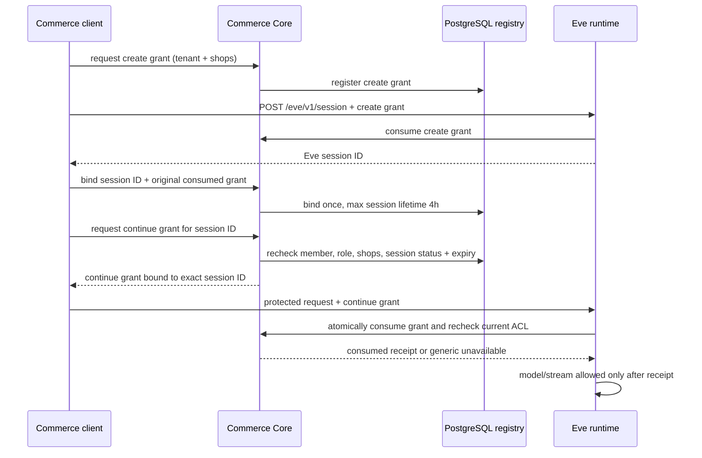

# EVE-CANARY-08 — Core-owned Session Continuation and Per-session ACL

สถานะ: **Engineering complete / Synthetic read-only protocol / Live AI disabled / canary BLOCKED**
วันที่: 16 พฤศจิกายน 2026

## ผลลัพธ์

Commerce Core เป็นเจ้าของทะเบียนสิทธิ์ของ Eve session แล้ว Eve ยังคงเป็นเจ้าของ
conversation history และ durable execution แต่ session ID เพียงอย่างเดียวไม่ให้สิทธิ์อ่าน
หรือดำเนิน session ต่อ ผู้ใช้ต้องขอ signed one-time grant ใหม่จาก Core สำหรับทุก protected
request และ Eve ต้อง consume grant ผ่าน Core ก่อนเริ่ม turn หรือเปิด stream

งานนี้ไม่เปิด Live AI, ไม่เพิ่ม model key, ไม่ deploy, ไม่เชื่อม production account และ
ไม่เพิ่ม inventory/financial mutation tool

## Protocol



## Protected routes

Core-scoped auth ครอบคลุม route ที่ Eve ระบุใน package `eve@1.0.0-rc.10`:

- `POST /eve/v1/session`
- `POST /eve/v1/session/:sessionId`
- `POST /eve/v1/session/:sessionId/{cancel,compact,clear,end}`
- `GET /eve/v1/session/:sessionId/stream`

create grant ใช้ได้เฉพาะ route แรก ส่วน continuation grant ต้องมี `sessionId` ตรงกับ URL
ทุก request ใช้ grant คนละใบเพื่อให้ replay และ request ที่แข่งกันมีผู้ชนะเพียงหนึ่งราย

## Security properties

- Session registry ผูก `sessionId` กับ tenant, subject, shops, initial grant, environment,
  policy version, creation role, expiry และสถานะ
- initial grant ที่ consume แล้ว bind ได้ครั้งเดียวภายในหน้าต่างจำกัด; Eve session ID ใช้ซ้ำ
  ข้าม tenant หรือ initial grant ไม่ได้
- continuation issuance ตรวจ membership/role/shop grant ล่าสุดผ่าน tenant transaction
- continuation consumption ตรวจ membership, active user, current role, shop access,
  session status และ expiry ซ้ำอีกครั้ง จึงปิด race ระหว่าง issuance กับ request
- revoke session ยกเลิก continuation grants ที่ยัง active ทันที; route-policy revoke ยกเลิก
  ทั้ง active grants และ active sessions ของ tenant
- Session ID อยู่ใน signed claims และต้องตรงกับ URL ก่อน Eve คืน auth context
- ตาราง session เปิด RLS: เจ้าของ session อ่านได้; Owner/Auditor ของ tenant อ่านได้;
  tenant อื่นได้ผลว่าง
- metadata/audit ไม่เก็บ prompt, model response, customer content หรือ signed token
- shared PostgreSQL rate limit และ telemetry จาก EVE-CANARY-07 ยังใช้กับ continuation grant

## Code references

- `packages/db/migrations/0052-agent-session-continuation.sql` — session registry,
  bind/read/revoke functions, current-ACL consume และ RLS
- `packages/agent-session-auth/src/index.ts` — signed `create`/`continue` claims และ
  session-ID invariant
- `packages/agent-session/src/index.ts` — create/continue issuance, bind และ revoke boundary
- `packages/db/src/index.ts` — Core DB adapters และ route-revoke cascade
- `apps/web/app/api/tenants/[tenantId]/agent-session/bind/route.ts` — authenticated bind API
- `apps/web/app/api/tenants/[tenantId]/agent-session/sessions/[sessionId]/revoke/route.ts` — human revoke API
- `apps/agent-runtime/agent/lib/commerce-canary-auth.ts` — exact route/session matching and consume-before-model
- `tests/agent-session-continuation.test.ts` — bind-once, one-time continuation,
  RLS, current ACL, revoke และ expiry
- `apps/agent-runtime/tests/commerce-canary-auth.test.ts` — message/control/stream negative security harness

## Verification

```text
Integration test files 42/42 passed
Integration tests      274/274 passed
Agent runtime files      9/9 passed
TypeScript / ESLint      passed
Next.js production build passed
Eve local build          passed on Node 24
```

Integration suite สร้างฐานข้อมูลใหม่และ apply migrations 0001–0052 จากศูนย์ ไม่แก้
checksum ของ migration เก่า

## ข้อจำกัดที่ยังเหลือ

1. Commerce UI/client ยังต้องเรียก bind หลังได้รับ Eve session ID; รอบนี้ตรวจ contract
   และ service boundary โดยตรง ยังไม่ได้เปิดหน้า live chat
2. Eve `end` ไม่เปลี่ยน Core session เป็น ended อัตโนมัติ; session จึงหยุดได้ด้วย revoke
   หรือ expiry แต่ lifecycle reconciliation ยังไม่ครบ
3. Session metadata ยังไม่มี cleanup retention policy; grant retention เดิมทำงานตามปกติ
4. session lifetime engineering POC ถูกตรึงสูงสุด 4 ชั่วโมง ยังไม่ใช่ production decision
5. external identity/secrets, data policy, model budget, monitoring SLO และ incident owners
   ยังไม่อนุมัติ ดังนั้น readiness gate ยัง BLOCKED 0/6 approvals

## งานถัดไปที่แนะนำ

**EVE-CANARY-09 — Session lifecycle handshake, end-state reconciliation and bounded retention**

เพิ่ม Commerce client handshake หลัง Eve create, ปิด Core session เมื่อ end/revoke,
จัดการ abandoned bind และกำหนด retention ของ metadata พร้อม protocol E2E ที่ไม่มี model call
