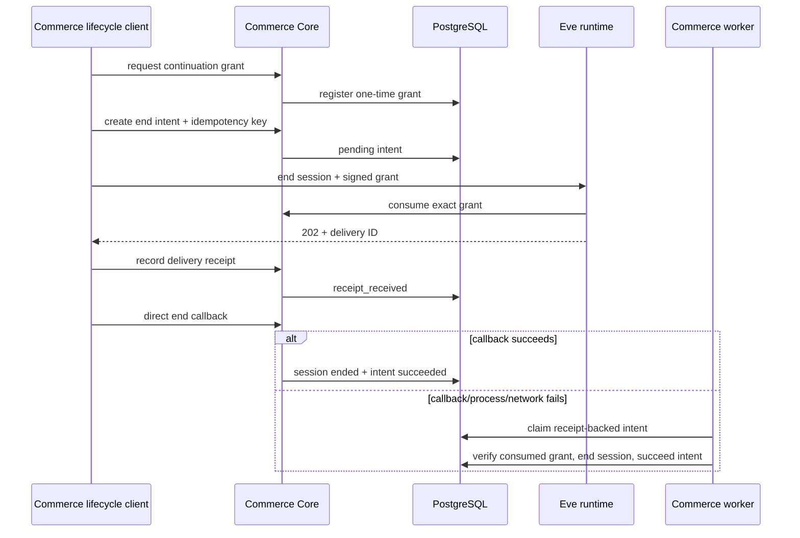

# EVE-CANARY-10 — Durable Lifecycle Reconciliation Queue

สถานะ: **Engineering complete / Synthetic evidence / Live AI disabled / canary BLOCKED**
วันที่: 16 พฤศจิกายน 2026

## ผลลัพธ์

เพิ่ม durable reconciliation boundary ระหว่าง Commerce Core และ Eve สำหรับการจบ session
โดยไม่บันทึก signed grant, prompt, model response หรือข้อมูลลูกค้า ลำดับใหม่บันทึก end intent
ใน PostgreSQL ก่อนเรียก Eve และบันทึก Eve acceptance receipt หลัง Eve ตอบรับ จากนั้น Core
callback ปิด session ได้ทันที หรือ worker ปิดแทนได้หาก callback ขาดหาย

Emergency revoke ยังปิด session และ continuation grants ใน Commerce Core ทันที พร้อมสร้าง
`revoke_cleanup` intent เพื่อแสดงว่างาน cleanup ฝั่ง Eve ยังไม่มีหลักฐานสำเร็จ Intent นี้จะกลายเป็น
terminal mismatch หากไม่มี receipt ภายใน 15 นาที จึงไม่ทำให้หน้าปฏิบัติการเข้าใจผิดว่า cleanup
ภายนอกเสร็จแล้ว

## Protocol



## Persistence and state rules

`app.agent_session_reconciliations` ใช้ primary key แบบ `(tenant_id, id)` และมี unique
`(tenant_id, idempotency_key)` Intent อ้าง exact session และ continuation grant ผ่าน foreign
key ภายใน tenant เดียวกัน

| State | เงื่อนไข | การเปลี่ยนต่อไป |
|---|---|---|
| `pending` | Core รับ intent แล้ว แต่ยังไม่มี Eve receipt | `receipt_received` หรือ `failed/EVE_RECEIPT_MISSING` หลัง 15 นาที |
| `receipt_received` | Eve ตอบรับและ Core บันทึก delivery ID แล้ว | `succeeded`, retry แบบ bounded หรือ `failed/CORE_SESSION_MISMATCH` |
| `succeeded` | Core session เป็น `ended` และหลักฐานครบ | terminal |
| `failed` | receipt หายหรือ Core state/grant ไม่ตรงหลัง retry ครบ | terminal และแสดงใน metrics |

Worker ทำ reconciliation ทุก 30 วินาที ใช้ advisory transaction lock และ
`FOR UPDATE SKIP LOCKED` เพื่อไม่ให้ worker หลาย instance ทำรายการเดียวกันพร้อมกัน Retry
ใช้ exponential backoff ที่มีเพดาน และหยุดเมื่อครบ 5 ครั้ง

## Idempotency and failure boundaries

- การสร้าง intent ซ้ำด้วย idempotency key, session, grant และเหตุผลเดิม คืน intent เดิม
- key เดิมแต่ payload ต่างกันถูกปฏิเสธด้วย `AGENT_SESSION_INTENT_CONFLICT`
- receipt ซ้ำด้วย delivery ID เดิมคืนผลเดิม; delivery ID ต่างกันถูกปฏิเสธ
- direct callback และ worker ทำเฉพาะ end intent ที่มี receipt และ request grant ถูก consume แล้ว
- direct callback และ worker ต่างปิด unused continuation grants ภายใน transaction เดียวกับ
  session state
- audit `agent.session.ended` จาก worker มี `source=durable-reconciliation` และไม่ซ้ำเมื่อ
  worker รันใหม่
- client แยก error ก่อน Eve รับ (`CORE_END_INTENT_FAILED`, `EVE_END_FAILED`) ออกจาก
  error หลัง Eve รับ (`CORE_END_RECEIPT_FAILED`, `CORE_END_RECONCILIATION_PENDING`)

## Operator evidence

`app.agent_session_reconciliation_metrics()` จำกัด Owner/Auditor และคืนเฉพาะ metadata:

- `pendingEnd`
- `pendingRevokeCleanup`
- `failed`
- `oldestPendingSeconds`

ผลลัพธ์ระบุ `contentCaptured=false` เสมอ Operator จึงเห็น backlog และ terminal mismatch โดย
ไม่ต้องอ่าน conversation content

## Security and tenant isolation

- ทุก user-facing operation ทำผ่าน authenticated Commerce context และ tenant transaction
- end intent ตรวจ signed continuation grant, exact tenant, subject, session และ capability
- receipt รับได้เฉพาะผู้ขอ intent เดิม
- RLS ให้ requester อ่านรายการของตน และให้ Owner/Auditor อ่านภายใน tenant เดียวกัน
- worker ใช้ `commerce_queue` และได้รับสิทธิ์เฉพาะ reconciliation function
- table ไม่ให้ runtime roles เขียนโดยตรง
- ไม่มี signed token, prompt, response หรือ customer content ใน reconciliation table/audit

## ข้อจำกัดที่ยืนยันไว้

1. ระบบนี้ durable ตั้งแต่ Core บันทึก intent สำเร็จ หาก browser ปิดก่อน request แรกถึง Core
   จะยังไม่มี intent ให้กู้คืน
2. หาก Eve รับ end แล้ว แต่ receipt ส่งกลับ Core ไม่สำเร็จ intent จะ timeout เป็น
   `EVE_RECEIPT_MISSING` เพื่อให้คนตรวจ ไม่สรุปเองว่า Eve ไม่ได้รับงาน
3. worker ไม่เรียก Eve และไม่มี runtime cleanup credential ดังนั้น `revoke_cleanup` แสดงงานค้าง
   และ timeout เท่านั้น การ cleanup ฝั่ง Eve ต้องทำหลังอนุมัติ service identity
4. Core metadata retention ไม่ได้กำหนด Eve conversation retention/deletion policy
5. canary approval gates 6 รายการยังเป็น proposed จึงห้ามเปิด model, live data หรือ production
   account

## Code references

- `packages/db/migrations/0054-agent-session-reconciliation.sql`
- `packages/db/src/index.ts`
- `packages/agent-session/src/index.ts`
- `packages/agent-session/src/client.ts`
- `apps/web/app/api/tenants/[tenantId]/agent-session/sessions/[sessionId]/end-intents/route.ts`
- `apps/web/app/api/tenants/[tenantId]/agent-session/sessions/[sessionId]/end-intents/[intentId]/receipt/route.ts`
- `apps/web/app/api/tenants/[tenantId]/agent-session/reconciliation-metrics/route.ts`
- `apps/worker/src/index.ts`
- `tests/agent-session-lifecycle-client.test.ts`
- `tests/agent-session-reconciliation.test.ts`

## Verification

```text
Integration test files 45/45 passed
Integration tests      289/289 passed
Agent runtime tests        9/9 passed
TypeScript / ESLint        passed
Next.js production build  passed
Canary technical gates     10/10 verified
Canary approval gates       0/6 approved — BLOCKED / NO-GO
```

## งานถัดไปที่แนะนำ

**EVE-CANARY-11 — Runtime cleanup identity and Eve retention policy rehearsal**

ออกแบบ service identity สำหรับ cleanup ที่จำกัด tenant/session/action, rotation และ revocation
พร้อมกำหนด Eve retention/deletion receipt และซ้อมด้วย synthetic session งานนี้ผูกกับ
`CANARY-IDENTITY-SECRETS` และ `CANARY-DATA-POLICY`; ต้องไม่มี production credential หรือ
live data จนกว่าจะมีผู้อนุมัติตาม gate
