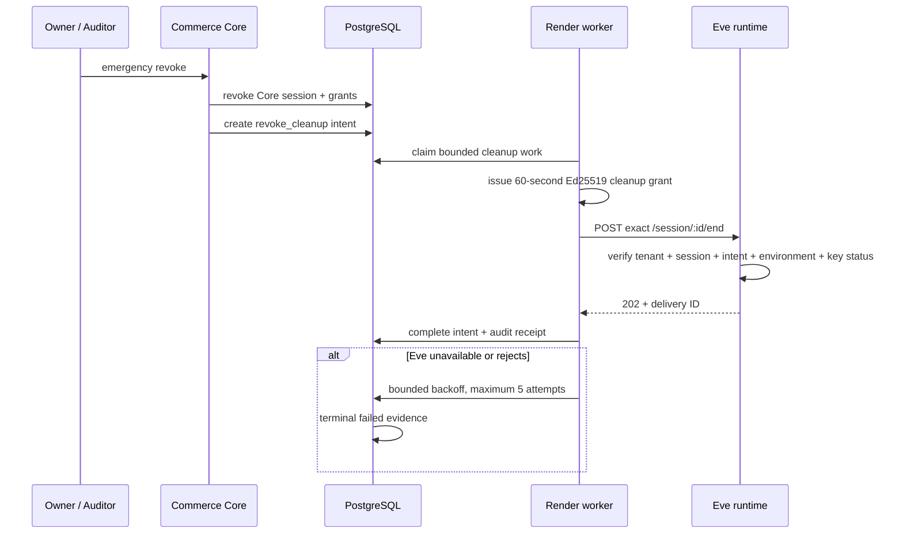

# EVE-CANARY-11 — Runtime Cleanup Identity and Retention Rehearsal

สถานะ: **Engineering complete / Synthetic only / Disabled by default / canary BLOCKED**
วันที่: 16 พฤศจิกายน 2026

## ผลลัพธ์

ปิดช่องว่างของ emergency revoke ระหว่าง Commerce Core และ Eve ด้วย cleanup service identity
แบบ short-lived Ed25519 หลัง Core revoke session และ grants ทันที Render worker สามารถ claim
`revoke_cleanup` intent, ออก credential ที่ผูก exact tenant, session, intent และ environment,
เรียก Eve end route แล้วบันทึก delivery receipt กลับ PostgreSQL

ฟังก์ชันนี้ปิดเป็นค่าเริ่มต้น (`COMMERCE_AGENT_CLEANUP_ENABLED=false`) และใช้ได้เฉพาะ
`local-demo` หรือ `staging-demo` โค้ดรอบนี้ไม่ได้เพิ่ม production credential, ไม่ deploy,
ไม่เรียก model และไม่เชื่อม production account

## Cleanup flow



## Identity contract

Cleanup token ใช้ prefix `ccl1_`, audience `commerce-eve-cleanup`, subject
`commerce-lifecycle-worker` และ capability เดียวคือ `cleanup:end`

| Control | ค่า engineering |
|---|---|
| Algorithm | Ed25519 / `EdDSA` |
| Default TTL | 60 วินาที |
| Maximum TTL | 120 วินาที |
| Scope | `tenantId`, `sessionId`, `intentId`, `environment` |
| Allowed route | `POST /eve/v1/session/:exactSessionId/end` |
| Principal type | `service` |
| Trusted keys | สูงสุด 3 public keys |
| Rotation | current + previous ชั่วคราว |
| Emergency revoke | deny key ID ทันทีและนำ public key ออกจาก keyring |

Credential นี้ใช้ส่ง message, stream, compact, clear หรือเข้าถึง session อื่นไม่ได้ Private key
อยู่ฝั่ง Commerce worker เท่านั้น ส่วน Eve รับเฉพาะ public keys

## Queue and receipt behavior

- `commerce_queue` เป็น role เดียวที่ claim/complete/fail cleanup ได้
- claim ใช้ `FOR UPDATE SKIP LOCKED`, lease 60 วินาที และไม่เก็บ signed token
- failure ใช้ exponential backoff และหยุดเมื่อครบ 5 attempts
- success ต้องมี Eve delivery ID ที่ผ่านรูปแบบและ exact session response
- success เขียน audit `agent.session.cleanup_confirmed` พร้อม source
  `cleanup-service-identity`
- operator metrics เดิมแสดง pending cleanup และ terminal failed โดยไม่เก็บ conversation content

## Retention policy

Root Commerce Lead และ subagents ทั้งสองตั้ง
`experimental.workflow.retention: 0` เพื่อขอให้ Workflow World ลบ run/step inputs,
outputs, errors, event payloads และ stream content เมื่อ session terminal

Synthetic retention evidence จะผ่านเมื่อ:

1. session จบแล้ว
2. Workflow World รองรับ spec version 4 ขึ้นไป
3. terminal stream อ่านไม่ได้ (`expired`) หรือว่าง
4. exported trace ไม่เก็บ content
5. model-provider retention mode ได้รับอนุมัติ

ข้อจำกัดสำคัญของ Eve retention `0`:

- ไม่ลบข้อมูลที่ model provider เก็บ
- Workflow metadata เช่น IDs, timestamps, statuses และ attributes อาจอยู่ตาม default period
- tool/channel storage และ exported telemetry ต้องมี retention policy แยก
- transcript ที่ลบแล้วใช้ support/debug ไม่ได้ จึงต้องเก็บเฉพาะ business evidence ที่ลดรูปใน
  Commerce Core ก่อน session จบ

ค่าที่ตรวจได้อยู่ใน `config/eve-cleanup-retention-policy.json` โดย agent ทั้งสามตัวบังคับใช้
Vercel AI Gateway request-level ZDR และ no-training แล้ว หลักฐาน catalog/endpoint และ code
configuration อยู่ที่ `docs/evidence/eve-canary-provider-retention-2026-11-16.json` ส่วน production
secret ยังคง `not-configured` และยังไม่มี live canary routing metadata

## Rotation and failure rehearsal

ชุดทดสอบยืนยันว่า:

- current และ previous public key ใช้ร่วมกันได้ใน rotation window
- key ID ที่อยู่ใน explicit revoked list ถูกปฏิเสธทันที
- token หมดอายุ, environment ผิด, signature ถูกแก้ หรือ keyring เกินขอบเขตถูกปฏิเสธ
- cleanup token ใช้กับ session/route อื่นไม่ได้
- queue บันทึก success receipt และ exact retry ได้
- Eve unavailable ครบ 5 ครั้งกลายเป็น terminal failure
- zero-retention evidence ไม่ผ่านหาก Workflow spec เก่า, content trace ยังเปิด หรือ provider
  policy ยังไม่อนุมัติ

## Code references

- `packages/agent-session-auth/src/index.ts` — cleanup grant issue/verify และ rotation/revoke
- `apps/agent-runtime/agent/lib/commerce-cleanup-auth.ts` — exact Eve end-route authenticator
- `apps/agent-runtime/agent/lib/retention-policy.ts` — zero-retention และ evidence evaluator
- `apps/agent-runtime/agent/agent.ts` — root retention setting
- `apps/agent-runtime/agent/subagents/*/agent.ts` — child retention setting
- `packages/agent-session/src/cleanup-client.ts` — bounded Core-to-Eve dispatcher
- `packages/db/migrations/0055-agent-session-cleanup-dispatch.sql` — claim/complete/fail queue API
- `apps/worker/src/index.ts` — disabled-by-default cleanup dispatch loop
- `tests/agent-cleanup-auth.test.ts`
- `tests/agent-session-cleanup-client.test.ts`
- `tests/agent-session-reconciliation.test.ts`
- `apps/agent-runtime/tests/commerce-cleanup-auth.test.ts`
- `apps/agent-runtime/tests/retention-policy.test.ts`

## Verification

```text
Integration test files 47/47 passed
Integration tests      297/297 passed
Agent runtime tests      11/11 passed
TypeScript / ESLint        passed
Next.js production build   passed
Eve Node 24.22.3 build     passed
Canary technical gates     11/11 verified
Canary approval gates       0/6 approved — BLOCKED / NO-GO
```

## เมื่อไรจึงเริ่มใช้งานจริงได้

สถานะปัจจุบันพร้อมสำหรับ **local synthetic test** เท่านั้น ขั้นต่อไปไม่มี technical POC gate
ค้าง แต่ยังมี human/operational gates ที่ระบบไม่ควรอนุมัติแทนคน

| ระดับใช้งาน | เริ่มได้เมื่อ | ประมาณการเมื่อ input พร้อม |
|---|---|---:|
| Demo/UAT ด้วยข้อมูลสังเคราะห์ | ตอนนี้ | ทันที |
| Internal staging canary แบบ read-only | approval gates 6 รายการ, staging secrets, Render/Vercel deploy, alert และ rollback rehearsal ผ่าน | 3–5 วันทำการหลังผู้มีอำนาจอนุมัติและส่ง secrets |
| Pilot ร้านแรกด้วยข้อมูลจริงแบบ read-only | staging canary ไม่มี isolation/evidence/retention incident, data policy/DPA ผ่าน, ร้านยืนยัน UAT | เพิ่มอีกประมาณ 1–2 สัปดาห์ |
| Production หลายร้าน | pilot มีผลจริง, monitoring/on-call/SLO, backup/restore, billing/support และ marketplace approvals พร้อม | ประมาณ 3–6 สัปดาห์หลัง pilot; ไม่รวมเวลารอ TikTok อนุมัติ |

ตัวแปรภายนอกที่กำหนดวันแน่นอนคือ TikTok Partner registration/scope review, การเลือก model
provider/retention mode, secret manager, monitoring provider และรายชื่อ incident owners

## งานถัดไป

**EVE-CANARY-12 — Approval closure and first staging synthetic canary**

งานนี้ต้องให้ผู้มีอำนาจจริงอนุมัติ controls 6 gates ก่อน จากนั้นจึงใส่ staging-only secrets,
deploy Render worker/Core และ Vercel Eve runtime, ซ้อม alert/rollback และเปิด synthetic canary
แบบมีกรอบเวลา หากไม่ผ่านข้อใดต้องคง legacy route และ cleanup dispatcher ไว้ที่ disabled
